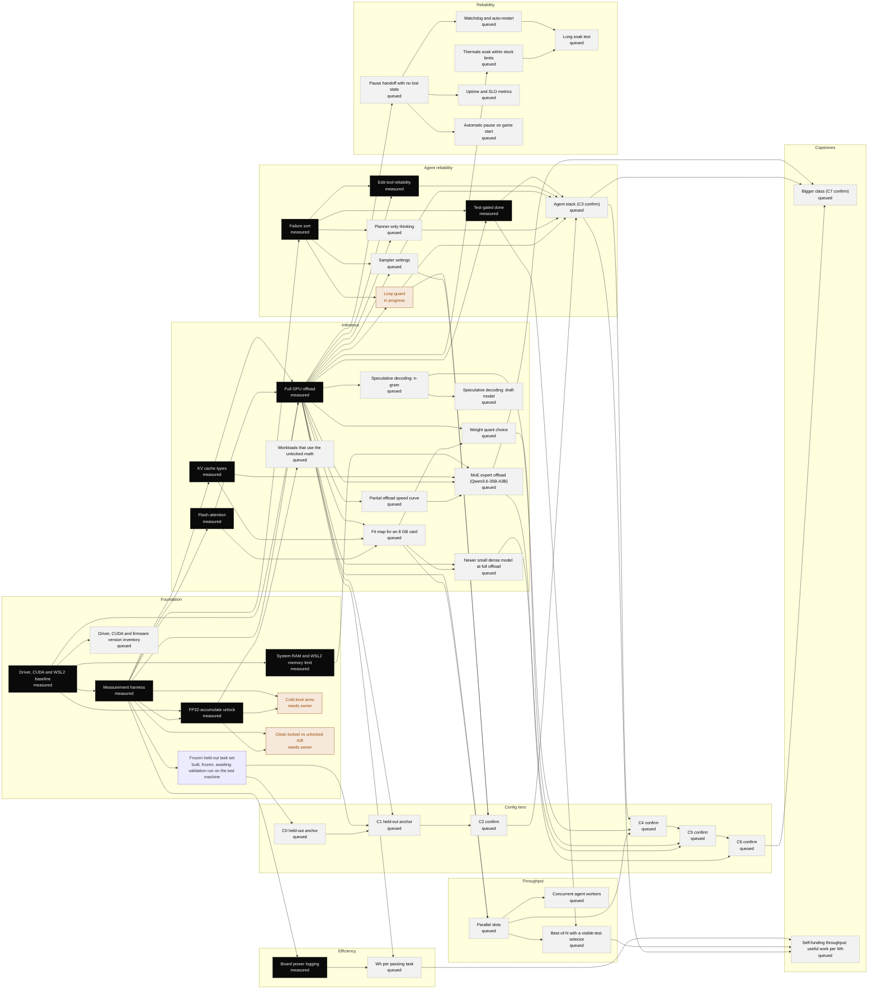

# RTX 3070 tech tree

Version 1.5.3. Updated 2026-10-30.

This tree shows how to get the most real work from one RTX 3070 with 8 GB of VRAM. LHR cards are included. The work is local LLM inference and coding agents. Each node is one experiment. A node runs only when all of its prereqs are measured. The machine-readable form is [`tech-tree.json`](tech-tree.json).

All numbers in this file come from one test machine. All runs are warm, not cold boot. The sample sizes are small. Each measured value names its source file. A value marked "Target" is a goal. It is not a result.

## Status counts

| status | nodes |
|---|---:|
| measured | 11 |
| in progress | 1 |
| paused | 0 |
| queued | 30 |
| needs owner | 2 |
| blocked | 0 |
| total | 45 |

Status values: `measured` means done. `in_progress` means the lab runs it now. `paused` means the lab started it and stopped. Its dependents wait, and it restarts from scratch. `queued` means ready, or ready when its prereqs are measured. `needs_owner` means the owner must be present or must give the go. `blocked` means a prereq is not available.

## Baseline

Unlocked agent bench, partial offload, warm: 3 of 36 passes, 1.716 passes per hour, 18.22 median output tok/s. Model Qwen3-8B Q4_K_M on llama.cpp b11734. Server: -ngl 30 (inferred), ctx 24576 (inferred), KV q4_0/q4_0 (inferred). The -ngl, ctx and KV values are the lab defaults at that time. They are inferred from the serve script defaults, not from a log of the launch line. Sources: `results/agent-bench/unlocked/summary.json`, `results/full-offload.md`.

## Config tiers

Each tier stacks on the tier below. A tier counts only after it meets the pass criteria against the tier below on the frozen held-out set. Config files are published for C0 and C1. For C2 and up, the result and how it was measured are published.

| tier | name | what it adds | confirm node | config file | status | held-out result |
|---|---|---|---|---|---|---|
| C0 | Baseline, partial offload | Starting point: the 8B model with part of its layers in system RAM. | `c0-anchor` | `configs/C0.json` | measured on dev set; held-out anchor queued | — |
| C1 | Full offload | All layers on the card, flash attention, 8-bit KV cache, context sized to the jobs. | `c1-anchor` | `configs/C1.json` | measured on dev set; held-out anchor queued | — |
| C2 | Agent loop and sampling fixes | C1 plus the loop-guard result and the winning sampler arm. | `c2-confirm` | not published | TBD | — |
| C3 | Planner thinking | C2 plus bounded thinking for the planner role, if it wins. | `agent-stack` | not published | TBD | — |
| C4 | Decode speed and concurrency | C3 plus speculative decoding and parallel slots, if they win. | `c4-confirm` | not published | TBD | — |
| C5 | Model or quant upgrade | C4 on a better quant or a newer small model, picked with the fit map. | `c5-confirm` | not published | TBD | — |
| C6 | Large MoE model | A 35B-total, 3B-active MoE model with experts in system RAM. | `c6-confirm` | not published | TBD | — |
| C7 | Bigger class capstone | The best large-model settings plus the agent fixes. | `bigger-class` | not published | TBD | — |

Excluded from every tier: `test-gate` (measured negative, reverted), `tool-call-format` (measured negative, reverted).

Pass criteria for each tier against the tier below:

- Frozen held-out set (heldout-set node): at least 72 tasks, 6 roles x 12, never used for tuning. Same task order, harness and power logging for both tiers. One run per task per tier at minimum (n >= 72 paired runs).
- c0-anchor and c1-anchor must complete every held-out run before any higher tier is compared.
- A tier beats the tier below if at least one holds: (a) pass rate: paired on the same tasks, exact McNemar one-sided p < 0.05 for more passes (equivalently the 95% CI of the paired pass-rate difference is above 0); (b) passes per hour at least 1.10x; (c) median agent decode tok/s at least 1.10x.
- And none of these regress beyond the margin: pass rate, the lower bound of the 95% CI of the paired difference above -5 percentage points (non-inferiority); passes per hour at least 0.95x; median agent decode tok/s at least 0.95x; board Wh per pass at most 1.10x.
- Fits in 8 GB: peak VRAM logged at 1 s for the whole run, at most 8192 MiB, zero out-of-memory errors. For C6 and up also log peak system RAM and swap; peak RAM must stay below the WSL2 cap minus 2 GiB.
- Report n, both tiers' pass rates with 95% Wilson CIs, the paired table (both pass, only upper, only lower, neither), passes per hour, decode tok/s, Wh per pass and peak VRAM MiB.

## Graph



## Next order

The lab runs these nodes in this order. The held-out set and the C0 and C1 anchors come first. Then each tier's nodes and its confirm run, then reliability, firmware and capstone nodes.

| rank | node | reason |
|---:|---|---|
| 1 | `heldout-set` | Frozen held-out set. Every tier is judged on it. |
| 2 | `c0-anchor` | C0 floor on the held-out set. |
| 3 | `c1-anchor` | C1 on the held-out set. Base for every higher tier. |
| 4 | `loop-guard` | In progress. 28 of 36 runs in the full-offload run had a loop event. |
| 5 | `sampler` | Two sampler arms, per request, no server change. |
| 6 | `c2-confirm` | C2 against C1 on the held-out set. |
| 7 | `thinking-budget` | Bounded thinking for the planner role, per request. |
| 8 | `agent-stack` | C3 against C2 on the held-out set. |
| 9 | `spec-ngram` | Short run with no VRAM cost. |
| 10 | `fit-map` | Before parallel-slots: the largest slot count runs only if the fit map shows the KV fits. Also settles the model file check. |
| 11 | `parallel-slots` | Fixed context per slot; the largest slot count only if it fits. |
| 12 | `c4-confirm` | C4 against C3 on the held-out set. |
| 13 | `quant-choice` | Which quant to pick at full offload. It uses the fit-map limits. |
| 14 | `dense-newer` | Which newer small model to pick at full offload. It uses the fit-map limits. |
| 15 | `c5-confirm` | C5 against C4 on the held-out set. |
| 16 | `offload-curve` | Shows how much speed is lost for each layer in system RAM. Agent decode is 57.54 tok/s at full offload and 18.22 tok/s at -ngl 30. |
| 17 | `moe-offload` | Shows if a 35B MoE model is usable on an 8 GB card with its experts in system RAM. The WSL2 memory cap is now 24 GB (WSL2 reports 23 GiB). |
| 18 | `c6-confirm` | C6 against C5 on the held-out set. |
| 19 | `pause-handoff` | Pause and start path of the prepared package (manual trigger). |
| 20 | `uptime-slo` | Background observer: start it, then go on. It blocks nothing. |
| 21 | `auto-pause-trigger` | The watcher only logs games today. This makes it pause and start the server. |
| 22 | `thermal-soak` | C1, no request proxy, 4 h. Full offload runs at 203.1 W mean of a 220 W limit. Logging only. |
| 23 | `watchdog-restart` | Crash recovery with state restored. Back-off is expected to miss 30 s from kill 3 on. |
| 24 | `driver-inventory` | Read-only version inventory. Upgrade candidates are research entries only. |
| 25 | `wh-per-pass` | Free with each bench once power logging starts before task 1. |
| 26 | `spec-draft` | Bigger speed-up, but it costs VRAM. |
| 27 | `best-of-n` | Uses spare slots to lift the 0-pass roles. |
| 28 | `agent-workers` | More jobs per hour if the CPU keeps up. |
| 29 | `fp16-workloads` | The only place the unlock pays. Unlocked-only numbers until locked-ab runs. |
| 30 | `bigger-class` | Capstone and C7 confirm against C6. |
| 31 | `useful-work-per-wh` | Capstone. Runs when its prereqs are measured. |
| 32 | `long-soak` | Last. 24 h on C1, no request proxy. |

## Node notes

- `moe-offload` (queued): The WSL2 memory cap is now 24 GB (WSL2 reports 23 GiB)..

## Nodes

### Foundation

Know the stack, measure it the same way every time, and confirm the FP32-accumulate unlock.

| id | goal | test | metric | target | status | result |
|---|---|---|---|---|---|---|
| `stack-baseline` | Record the exact software and card state so that every other result can be replicated. | Read-only queries: nvidia-smi (name, driver, power limit, VRAM), llama.cpp build number, model file. Record them in every session. | Recorded fields present in each session meta file (yes/no). | Target: every session records driver, llama.cpp build, model, power limit and display GPU. | measured | driver: 621.01; power limit: 220 W, not changed; llama.cpp build: b11734, CUDA backend; model: Qwen3-8B Q4_K_M (4.68 GiB); runtime: llama.cpp in WSL2 |
| `harness` | Run the same benchmarks the same way, with n, variance and warm or cold state labeled on every number. | llama-bench with -r 5 and 3 reps for raw speed. A 12-task agent coding bench (6 roles x 2 tasks, hidden checks) at n=3 per task (36 runs). Board power sampled every 5 s. Summaries with 95% confidence intervals. | Pass rate with 95% CI, passes per hour, median output tok/s, board Wh per task, run-to-run spread. | Target: every result states n, warm or cold, and its confounds. | measured | agent bench baseline (unlocked): 3 of 36 passes, 8.3%, 95% CI 2.9-21.8%; agent bench passes per hour (unlocked, serial): 1.716; agent bench median output tok/s (unlocked): 18.22; agent bench baseline (locked): 2 of 24 passes, 8.3%, 95% CI 2.3-25.9% |
| `unlock-fp32acc` | Confirm that FP16 tensor-core math with FP32 accumulate runs at the full rate. | MMA microbenchmark: FP16 inputs with FP32 accumulate vs FP16 accumulate. Then a GEMM diagnostic at model-shaped sizes. | mma ratio = FP32-acc rate / FP16-acc rate. Locked GeForce Ampere is near 0.5. Unlocked is near 1.0. | Target: ratio 1.0 in every unlocked session. | measured | mma ratio, locked: 0.507; mma ratio, unlocked: 1.0; mma ratio, unlocked replication: 1.0; GEMM FP32acc/FP16acc, sq4096 (unlocked, median of 3): 1.014; GEMM FP32acc/FP16acc, pp512_qkv (unlocked, median of 3): 0.942 |
| `ram-wsl-check` | Find how much system RAM the WSL2 VM can use, and the longest context the jobs need. | Read-only: free -g and nproc inside WSL2. Read the context percentiles from existing agent runs. | Total RAM, WSL2 memory limit, free RAM with the lab server loaded, p95 of per-run max context. | Target: values recorded. The MoE node needs this result before the owner decides on the memory cap. | measured | Windows physical RAM: 32 GiB; WSL2 memory limit: 15.5 GiB (default 50% cap, no memory= line in .wslconfig); WSL2 available RAM with the lab running: 11.9 GiB; WSL2 swap: 4.0 GiB, 0 used; WSL2 processors: 8 (.wslconfig processors=8); p95 of per-run max context: pending, from full-offload |
| `cold-boot` | Measure power-on to first token and power-on to first passing task, for unlocked and locked boots. | The owner cold-boots the machine and marks power-on and unlock-done times. The harness records boot, WSL up, server start, model ready, first token, warm, first pass. | Time to first token (s), time to first passing task (s), per arm. | Target: both arms measured with n of at least 3 boots each. | needs owner | — |
| `locked-ab` | Remove the display confound from the unlock comparison. | A locked cold boot with the display on the integrated GPU. Run the same llama-bench, GEMM, fa-off and agent bench as the unlocked arm. | Delta per metric, locked vs unlocked, same display state. | Target: every unlock claim has a same-display locked baseline. | needs owner | — |
| `driver-inventory` | Record the driver, CUDA and firmware versions in use, and list newer driver and CUDA versions as research entries. | Read-only: record the Windows driver, the WSL CUDA driver and toolkit, the llama.cpp build and its CUDA version, and the VBIOS version string as reported by nvidia-smi. Research release notes for newer driver and CUDA versions. Install nothing. | Version table with the source of each value. Upgrade candidates with release-note claims that touch Ampere inference, each marked research only. | Target: every version in use recorded with its source. No change made to the machine. | queued | — |
| `heldout-set` | Freeze a task set that is never used for tuning, so each config tier is judged on tasks it was not tuned on. | Write at least 72 new tasks in the bench format (6 roles x 12), each with a hidden check and a reference solution that passes it. Freeze them with a sha256 manifest. Validate every check against its reference solution and against an empty change. No tuning run may use these tasks. | Task count per role, checks that pass the reference and fail the empty change, manifest sha256. | Target: at least 72 frozen tasks, 12 per role, 100% of checks valid. | built, frozen, awaiting validation run on the test machine | heldout-v1 frozen 2026-10-27: 72 tasks, 12 per role, 4 easy/4 medium/4 hard each. On the box: 72/72 references pass, 72/72 start states fail. Manifest sha256 dc99f4f60aa10a1f70457998dc40cfbf5774c0af962eedff080a0df462da3514 (505 files). Not yet run on the test machine. |

### Config tiers

Stack the wins into numbered configs C0 to C7. Each tier must beat the tier below on a frozen held-out task set.

| id | goal | test | metric | target | status | result |
|---|---|---|---|---|---|---|
| `c0-anchor` | Measure tier C0 (partial offload baseline) on the held-out set. | Run C0 on the full held-out set, every task, with power logged from before the first task. Launch with temperature 0.2, top-k 20, top-p 0.95, and pass --min-p 0.05 and --presence-penalty 0 explicitly; max output 4096 tokens for every role. Log the full launch line in meta.json. | Held-out pass rate with 95% CI, passes per hour, median agent decode tok/s, board Wh per task and per pass, peak VRAM MiB, runs completed. | Target: all held-out runs completed (anchor). No pass criteria; this is the floor. | queued | — |
| `c1-anchor` | Measure tier C1 (full offload) on the held-out set. | Run C1 on the full held-out set with the same harness, task order and power logging as c0-anchor. Launch with temperature 0.2, top-k 20, top-p 0.95, and pass --min-p 0.05 and --presence-penalty 0 explicitly; max output 4096 tokens for every role. Log the full launch line in meta.json. | Held-out pass rate with 95% CI, passes per hour, median agent decode tok/s, board Wh per task and per pass, peak VRAM MiB, runs completed. | Target: all held-out runs completed (anchor), and meets the tier pass criteria against C0. | queued | — |
| `c2-confirm` | Confirm tier C2 (agent loop and sampling fixes) against the tier below on the held-out set. | Run tier C2 on the frozen held-out set with the same harness, task order and power logging as the tier below. Apply the tier pass criteria. | Held-out pass rate with 95% CI, passes per hour, median agent decode tok/s, board Wh per pass, peak VRAM MiB. | Target: meets the tier pass criteria against the tier below. | queued | — |
| `c4-confirm` | Confirm tier C4 (decode speed-up and concurrency) against the tier below on the held-out set. | Run tier C4 on the frozen held-out set with the same harness, task order and power logging as the tier below. Apply the tier pass criteria. | Held-out pass rate with 95% CI, passes per hour, median agent decode tok/s, board Wh per pass, peak VRAM MiB. | Target: meets the tier pass criteria against the tier below. | queued | — |
| `c5-confirm` | Confirm tier C5 (model or quant upgrade) against the tier below on the held-out set. | Run tier C5 on the frozen held-out set with the same harness, task order and power logging as the tier below. Apply the tier pass criteria. | Held-out pass rate with 95% CI, passes per hour, median agent decode tok/s, board Wh per pass, peak VRAM MiB. | Target: meets the tier pass criteria against the tier below. | queued | — |
| `c6-confirm` | Confirm tier C6 (larger MoE model with experts in system RAM) against the tier below on the held-out set. | Run tier C6 on the frozen held-out set with the same harness, task order and power logging as the tier below. Apply the tier pass criteria. | Held-out pass rate with 95% CI, passes per hour, median agent decode tok/s, board Wh per pass, peak VRAM MiB. | Target: meets the tier pass criteria against the tier below. | queued | — |

### Inference

Get the most tokens per second from 8 GB of VRAM.

| id | goal | test | metric | target | status | result |
|---|---|---|---|---|---|---|
| `kv-cache-types` | Pick the KV cache type pair that is fast and fits. | Same 15,414-token prompt at 64K context, -ngl 30, 3 reps per K/V pair. Log the flash-attention fallback flag and peak VRAM. | Prefill tok/s, decode tok/s, peak VRAM MiB, fallback flag. | Target: no fallback, and the fastest decode that fits. | measured | q4_0/q4_0: prefill 1322-1350, decode 11.5-12.1 tok/s, 6393 MiB, no fallback; q8_0/q8_0: prefill 1277-1308, decode 9.6-10.2 tok/s, 7933 MiB, no fallback; q8_0/q4_1: prefill 1294-1311, decode 9.4-9.7 tok/s, 7473 MiB, fallback; q8_0/q4_0: prefill 1233-1330, decode 9.0-10.0 tok/s, 7355 MiB, fallback; f16/f16: prefill 92-95, decode 3.98-4.05 tok/s, 7935 MiB, no fallback |
| `flash-attention` | Confirm flash attention is on and measure what it gives at long prompts. | llama-bench -ngl 99, -fa 1 vs -fa 0, pp512/pp4096/pp16384. | Prefill tok/s per prompt length. | Target: flash attention on for every config. Re-check at each new build. | measured | pp16384, fa 1 (unlocked replication): 2492.6; pp16384, fa 0 (unlocked, 1 run x -r 5): 185.0; pp4096, fa 1 / fa 0: 2963.7 / 1976.4; pp512, fa 1 / fa 0: 2963.8 / 2726.3 |
| `full-offload` | Put every layer on the card at a context sized to real use. | llama-server -ngl 99 -fa on, context at p95 of real use (max 32k), KV q8_0/q8_0 (q4_0/q4_0 if it does not fit). Then the 36-run agent bench with board power logged from the first task. | Agent median output tok/s, passes per hour, pass rate, Wh per pass, out-of-memory count. | Target: agent decode at least 40 tok/s, passes per hour at least 1.5x baseline, pass rate not below 3 of 36, zero out-of-memory errors. | measured | verdict: Kept for throughput. All targets met: decode 57.54 tok/s vs 18.22 at partial offload (target 40), passes per hour 14.54 vs 1.716 (8.5x, target 1.5x), 6 of 36 passes (target: not below 3), zero OOM. The gain is in passes per hour and tok/s. The pass rate is not shown to be better: 6 of 36 vs 3 of 36 have overlapping 95% intervals. Full offload is the new current best config.; pass rate (36-run agent bench, card headless): 6 of 36 (16.7%, Wilson 95% CI 7.9% to 31.9%). Baseline at partial offload was 3 of 36 (8.3%, CI 2.9% to 21.8%). Intervals overlap, so no pass-rate gain is claimed.; passes per hour: 14.54 vs 1.716 at partial offload (8.5x); agent median output tok/s: 57.54; agent median wall s per task: 18.39 vs 73.4 at partial offload; board energy: 2.329 Wh per task (baseline 2.535), 13.97 Wh per pass, 1009 Wh per 1M output tokens, 203.1 W mean board power during the bench; out-of-memory count: 0; failure causes of the 30 non-passing runs: gofmt 9, tests 6, review 6, build 4, vet 3, rubric 1, missing output 1. gofmt, build and vet are 16 of 30.; context check (p95 basis): ctx 16384 covers per-run max context p95 6248 and observed max 10587; peak VRAM 6318 MiB of 8192, no context-exceeded errors in the server log.; server config in use: -ngl 99, ctx 16384, KV q8_0/q8_0 (confirmed from the running server args), FA on, 1 slot. VRAM 6312 MiB under load with the card headless.; reference only, discarded attempt: display on the 3070 (confounded, not a result): 36 of 36 runs completed, 4 passes. Agent median output 53.82 tok/s, 202.6 W mean board power. Discarded because the desktop was drawn on the 3070 (693 MiB, about 25% utilization, about 11 W at idle).; llama-bench tg128 at -ngl 99 (unlocked replication, warm): 73.8; lab server load test at partial offload, gen tok/s, 3 reps (before this node): 20.63 / 21.43 / 21.81; agent bench median output tok/s at partial offload (before this node): 18.22; per-run max context, unlocked bench: p50 / p95 / max (tokens): 2811.5 / 4396 / 6248; mma ratio FP32-acc / FP16-acc at bench start (unlock active): 1.0; VRAM, server steady footprint (measured): 6318 MiB: both the max and the median over 1485 one-second samples while the server ran. A second GPU log and the test-gate run agree. One sample of 6459 MiB at session start came from a concurrent CUDA context of the mma check, not from the server. C1 keeps 6459 MiB as its conservative 8 GB fit value.; server per-request timings (print_timing), about 2k context: n=47: prefill median 2889 tok/s, decode median 63.90 tok/s (p10 to p90 63.71 to 64.15). About 6k context, n=20: prefill 2749, decode 57.66. Agent requests: decode 61.53. |
| `fit-map` | Find which model, quant, context and KV cache settings fit fully on an 8 GB card, and how fast each runs. | Qwen3-8B at Q4_K_M, Q5_K_M, Q6_K and Q8_0, Qwen3.5-9B Q4_K_M, a 4B-class and a 14B-class Q4_K_M, all layers on the GPU, FA on. For each KV pair (f16, q8_0, q4_0), find the largest ctx that loads and serves a 512-token prompt. Record peak VRAM and llama-bench pp512/tg128 (n=3). | Max ctx, VRAM MiB, pp512 and tg128 tok/s. | Target: a table of every model, quant and KV pair with its max ctx, peak VRAM and speed. | queued | — |
| `offload-curve` | Show how speed falls as layers move from the card to system RAM. | llama-bench pp512/tg128 for Qwen3-8B Q4_K_M at -ngl 0, 8, 16, 24, 30 and all layers, ctx 4096, n=3. Then a 14B-class model up to the most layers that fit. Log VRAM and board power. | pp512 and tg128 tok/s per -ngl, VRAM MiB, board W. | Target: a speed curve per model from -ngl 0 to all layers. | queued | — |
| `quant-choice` | Find the weight quant with the best passes per hour that fits at full offload. | Other weight quants of the same model that fit at full offload. llama-bench, then the 36-run agent bench. | Pass rate, passes per hour, decode tok/s, VRAM headroom. | Target: pick the quant with the most passes per hour. No out-of-memory errors. | queued | — |
| `spec-ngram` | Speed up decode on edit-heavy roles with no extra VRAM. | Speculative decoding with no draft model. Token bench and 36-run agent bench. | Agent decode tok/s, draft acceptance rate, pass rate, Wh per pass. | Target: agent decode at least 1.3x with the same pass rate. | queued | — |
| `spec-draft` | Speed up code and JSON output with a small draft model. | Speculative decoding with a small draft model, if VRAM allows at full offload. Token bench and agent bench. | Agent decode tok/s, acceptance rate, VRAM, pass rate. | Target: agent decode at least 1.3x over n-gram mode or over no speculation. | queued | — |
| `dense-newer` | Test whether a newer small model passes more tasks at a similar speed. | A newer small model at full offload. Check its chat and tool-call template. llama-bench, then the 36-run agent bench. | Pass rate, decode tok/s, prefill tok/s. | Target: at least 10 of 36 passes at 40 tok/s or more. | queued | — |
| `moe-offload` | Run a 35B-total, 3B-active MoE model with some experts in system RAM. | A 35B-total, 3B-active MoE model with part of its experts in system RAM. A speed sweep, a context fit check, then the 36-run agent bench. Restore and verify the 8B config after. | Speed per expert-offload setting (pp512, pp4096, tg128) with RAM and VRAM peaks. Agent bench: passes per hour, pass rate, median output tok/s, board Wh per task and per pass, RAM minimum, swap use, truncations per role. | Target: at least 10 of 36 passes and agent decode at least 18 tok/s. A win does not replace the best config, because the model changes. | queued | — |
| `fp16-workloads` | Find end-to-end jobs that gain from FP32-accumulate FP16/BF16 math. | Unlocked arm: PyTorch fp16/bf16 matmul TFLOPS, an image-generation it/s run, and a BF16 vs F16 small-model llama-bench pp512/pp2048. | End-to-end speed per workload. Later: ratio vs the clean locked arm. | Target: at least 1.4x on one end-to-end FP16/BF16 workload vs the locked arm. | queued | — |

### Agent reliability

Make more agent tasks pass on the same model and card.

| id | goal | test | metric | target | status | result |
|---|---|---|---|---|---|---|
| `failure-sort` | Count why agent tasks fail, so that each fix targets a real cause. | Group all existing agent runs by failure cause, tool-call errors, loop events, output-limit hits and false 'done'. | Failures per cause, tool-call error share, runs with loops. | Target: a ranked cause list that sets the order of the agent fixes. | measured | runs / passes (locked 24 + unlocked 36): 60 / 5; failures by cause (55 failures): gofmt 17, review 10, timeout 8, rubric 6, build 6, tests 4, vet 2, missing_output 2; tool-call errors / tool calls: 311 / 661; runs with at least one loop event (non-empty loops field): 39 of 60 (locked 16 of 24, unlocked 23 of 36); 0 passes among them; runs with false_done = true: 8 of 60 (locked 5, unlocked 3); all 8 failed; output-limit hits (sum of length_hits): 20 hits in 18 runs (locked 9 in 7, unlocked 11 in 11); passes by role: planner (pm) 5 of 10; other five roles 0 of 50 |
| `test-gate` | Do not accept 'done' until format, vet, build and visible tests pass. | Before the agent can finish, run gofmt -l, go vet, go build and visible tests. On failure, return the output to the agent. 36-run agent bench. | Pass rate, passes per hour, gofmt/build/vet failure count, false 'done' count. | Target: gofmt, build and vet failures cut by half or more. Passes per hour above full-offload (14.54). | measured | verdict: Measured negative result. Reverted. 6 of 36 passes (same as full-offload), 9.64 passes per hour vs 14.54, 3.59 board Wh per task vs 2.33. gofmt, build and vet failures went from 16 to 15 of 30, so the gate did not cut them by half. It did not beat full-offload on passes per hour, so it is not carried into later nodes. The best config stays full-offload (base variant).; run: 36-run core agent bench (n=3) of variant testgate (attempts 2) at the full-offload config, card headless.; discarded attempt: wrong task set (not a result): The first run used the full task set (9 roles) because the core-set setting was missing from its environment. It was stopped at 52 runs (10 passes), with 31 of the 36 core rows done (4 passes). Not all 36 core rows were present, so it was archived and the node restarted on the core set.; lab chain result (36-run core bench): 6 of 36 passes, 9.64 passes per hour, median output 58.47 tok/s, 3.59 board Wh per task, 1.361 loop events per run, edit-error rate per edit call 0.494 (44 of 89), bash non-zero 70 of 116 (secondary), output-limit truncations 19, tool error share 0.368, failures {'build': 8, 'review': 6, 'gofmt': 5, 'tests': 5, 'ci_script': 2, 'rubric': 2, 'vet': 2}. Variant testgate. |
| `tool-call-format` | Cut edit-tool errors: oldText not found, not unique, or no change. | Edit-tool arm: precise mismatch errors (nearest match with line numbers, or the duplicate count), line-anchored edits, and a fuzzy match only on a unique hit after whitespace normalization. 36-run core agent bench on the current best config (variant editrel-on-base, or editrel-on-testgate if test-gate becomes best). The arm is opt-in in a separate patched pi copy; the live pi and the harness binary are unchanged. | Edit-error rate per edit call (edit errors excluding output-limit truncations, over all edit calls), passes per hour and pass rate (n=36, core set) against the current best config. Secondary only: bash non-zero exits per bash call. | Target: edit-error rate per edit call cut by half (baseline 52 of 110 edit calls, 47.3%; 52 of 363 of all tool calls). Passes per hour not below the current best config. | measured | verdict: Measured negative result. Reverted. 3 of 36 passes, 3.56 passes per hour vs 14.54, edit-error rate per edit call 0.67 vs 0.47, 4.90 board Wh per task vs 2.33. The best config stays full-offload (base variant).; baseline tool calls, full-offload run (not this node's result): 144 of 363 calls errored; 0 malformed. Calls by tool: bash 124, edit 110, read 81, write 48.; baseline edit mismatches (oldText not found, not unique, or no change): 52 of 110 edit calls (47.3%), 52 of 363 tool calls: not found 24, not unique 21, no change 7; baseline bash non-zero exits (secondary metric): 83 of 124 bash calls (83 of 363 tool calls); baseline output-limit truncations (moved to thinking-budget): 9 of 363 tool calls (write 5, edit 4); correction to the earlier lab count: The earlier per-call count gave bash 78 and truncations 14. A keyword match had put 5 bash errors whose output contained the word parse into the truncation class. The raw per-call log gives bash 83, truncation 9, edit 52 (total 144 unchanged).; grammar arm: Negative result: 0 of 363 calls were malformed, so a grammar has nothing to fix. pi already sends a strict JSON schema for tool calls. Not run.; lab chain result (36-run core bench): 3 of 36 passes, 3.56 passes per hour, median output 57.92 tok/s, 4.9 board Wh per task, 1.444 loop events per run, edit-error rate per edit call 0.667 (108 of 162), bash non-zero 246 of 291 (secondary), output-limit truncations 48, tool error share 0.652, failures {'gofmt': 9, 'build': 6, 'review': 6, 'tests': 3, 'rubric': 3, 'vet': 3, 'tampered': 2, 'missing_output': 1}. Variant editrel-on-base. Truncations per role: ci 163 of 240, debugger 23 of 141, implementer 7 of 98, pm 0 of 16, reviewer 0 of 29, testwriter 10 of 93. |
| `sampler` | Test recommended sampler settings against the lab defaults. | Two sampler arms, sent per request with no server change. 36-run core agent bench on the best config. Each arm is compared with the same base run. | Passes per hour (decision), pass rate, loop events per run, tool-call errors, Wh per task, truncations per role. | Keep an arm only if its passes per hour beat the base config. If both do, keep the higher one. Loop events and pass rate are reported, not used to decide. | queued | — |
| `thinking-budget` | Test whether bounded thinking helps the planner role. | Thinking on for one role only, with a bounded budget, sent per request. Every other role stays thinking-off. 36-run core agent bench on the best config. | Passes per hour, pass rate (overall and pm), board Wh per task, truncated tool calls and length stops per role (baseline 9 of 363 calls in the full-offload run: write 5, edit 4). | Keep only if passes per hour beat the base config. Report the pm pass rate and pm truncations separately. | queued | baseline output-limit truncations, full-offload run (not this node's result): 9 of 363 tool calls (write 5, edit 4). The earlier count of 14 included 5 bash errors by a keyword match. |
| `loop-guard` | Stop the agent from repeating the same tool call. | A harness change that stops repeated identical tool calls. 36-run agent bench. | Loop events per run, pass rate, wall time. | Target: loop events cut by half. | in progress | — |
| `agent-stack` | Combine the fixes that helped and check them on tasks that were not used to tune them. | Tier C3 on the 36-run bench and the held-out set against C2. Apply the tier pass criteria. | Pass rate on the tuned set and on the held-out set, reported apart. Passes per hour, Wh per pass, peak VRAM MiB. | Target: meets the tier pass criteria against C2 on the held-out set. | queued | — |

### Throughput

Keep the card busy while agents wait on builds and tests.

| id | goal | test | metric | target | status | result |
|---|---|---|---|---|---|---|
| `parallel-slots` | Serve 2-4 requests at once to fill idle GPU time. | Serve more than one request at once, with a fixed context per slot. A slot count runs only if the fit map shows its KV cache fits; otherwise it is recorded as "does not fit". Token bench at each setting. Log VRAM, power and temperature. | Aggregate tok/s, per-request tok/s, aggregate tok/s per board W. | Target: aggregate tok/s per board W at least 1.5x of 1 slot, at the largest slot count that fits. | queued | — |
| `agent-workers` | Run 2 agent jobs side by side. | Agent bench with 2 workers against a 2-slot server. | Passes per hour, pass rate, CPU load. | Target: passes per hour at least 1.5x vs 1 worker. | queued | — |
| `best-of-n` | Turn spare capacity into more passes. | Several attempts per task on the weak roles. Pick one using only visible checks. Never use the hidden check. | Role pass rate, passes per hour, Wh per pass. | Target: implementer + debugger from 0 of 12 to at least 3 of 12. | queued | — |

### Efficiency

Measure energy per passing task. Do not tune power.

| id | goal | test | metric | target | status | result |
|---|---|---|---|---|---|---|
| `power-log` | Log board power for every task with full coverage. | nvidia-smi power.draw at 5 s, read-only, started before the first task. | Board Wh per task, coverage share of tasks with power data. | Target: 100% of tasks covered. | measured | board Wh per task, locked / unlocked: 2.99 / 2.53; board Wh per pass, locked: 35.88; board W mean during agent bench, locked: 56.43; board peak W under llama load (pause bench): 174.8 |
| `wh-per-pass` | Report energy per passing task for every config. | Every agent bench reports board Wh per pass and tok/s per W. Add wall-meter data if a plug meter is fitted. | Board Wh per pass (and wall Wh per pass when available). | Target: Wh per pass at least 30% lower than the locked baseline after full offload. | queued | — |

### Reliability

Keep the server up around the clock within stock limits: pause, restart, thermals, uptime.

| id | goal | test | metric | target | status | result |
|---|---|---|---|---|---|---|
| `pause-handoff` | Give the GPU to another app (for example a game) and take it back with no lost model state. | Install the prepared 24/7 package: slot save on pause, slot restore on start. Use the full-offload config. Put a long context in slot 0 with a known fact in the middle. Run 20 pause and start cycles through the package commands. After each restore, ask for the fact. This tests the pause and start path only: the game watcher logs games but does not pause the server (auto-pause-trigger). | Pause wall s, resume wall s, slot save and restore ms, slot file MB, restores that answer the fact correctly, time to first token after restore vs cold re-read, VRAM after stop. | Target: 20 of 20 restores answer the fact correctly. Pause and resume each under 10 s wall. VRAM after stop under 1.5 GB. | queued | — |
| `watchdog-restart` | Bring the server back by itself after a crash, with state restored. | Run the server under the package supervisor (restart on failure, back-off from 10 s to 5 min). Kill the server process 10 times: idle, mid-request and mid-save. Measure time to healthy and the restore result after each kill. | Time to healthy s (median, max), restarts that restored state, requests lost per kill, supervisor give-ups, corrupt slot files. | Target: 10 of 10 kills back healthy in under 30 s. No restart loop. Zero corrupt slot files. | queued | — |
| `thermal-soak` | Show the card holds its speed under hours of load at stock limits. | Run the C1 config with the agent task mix for 4 h, requests sent straight to the server with no request proxy. Read temperature, board W, clocks and throttle reasons every 5 s. Logging only. | Max and p95 GPU temperature C, share of samples with each throttle reason, decode tok/s in the first hour vs the last hour, mean board W. | Target: last-hour decode tok/s within 5% of the first hour. No thermal throttle reason. No screen blanking. | queued | — |
| `long-soak` | Find faults that show only after a full day of load. | Run the C1 config for 24 h with a mixed request load sent straight to the server, no request proxy: short chat, 2000-token and 6000-token prompts, agent tasks. Pause and resume at random times. Log errors, restarts, VRAM and system RAM every minute. | Errors per 1000 requests, restarts, decode tok/s drift per hour, VRAM and system RAM growth per hour, slot disk use. | Target: under 1 error per 1000 requests. VRAM and RAM growth under 1% per hour. Each unplanned restart recovered by the watchdog. | queued | — |
| `uptime-slo` | Observe how much of each day the server is up and inside its latency targets. Background observer: it blocks no node. | Start the 24/7 package metrics (one sample per minute, daily rollups) after pause-handoff and leave them on for at least 7 days while other nodes run. Compute uptime outside pauses, pause minutes, restore results and request latency. The chain does not wait for it. | Server up share outside pauses, paused minutes per day, restores ok and failed, health timeouts, p50 and p95 time to first token, decode tok/s per request. | Target: up share outside pauses at least 99%. All restores ok. p95 time to first token under 5 s at 2000-token prompts. | queued | — |
| `auto-pause-trigger` | Make the game watcher pause the model server on a game start and start it again after the game exits. | Turn on the watcher pause action. Start and quit a test game 10 times, and leave the PC idle for 1 h with no game. Log each detected start, pause, exit and start, with timestamps. | Seconds from game start to server paused, seconds from game exit to server healthy, missed pauses, false pauses in the idle hour, restores that answer the known fact. | Target: 10 of 10 game starts paused within 15 s, 10 of 10 starts healthy within 90 s of exit, 0 false pauses. | queued | — |

### Capstones

Combine the wins into a bigger model class and more useful work per Wh.

| id | goal | test | metric | target | status | result |
|---|---|---|---|---|---|---|
| `bigger-class` | Run a 35B-class model on 8 GB that beats the 8B baseline on passes per hour. | Tier C7 on the held-out set against C6. Apply the tier pass criteria. | Pass rate, passes per hour, Wh per pass vs the 8B stack. | Target: meets the tier pass criteria against C6, and more passes per hour than the best 8B tier. | queued | — |
| `useful-work-per-wh` | Find the config with the most passing tasks per Wh and per hour on one card. | Combine the best inference, agent and throughput settings. Run a long agent bench with full power logs. | Passing tasks per Wh, passing tasks per hour. | Target: passing tasks per Wh at least 2x the locked baseline. | queued | — |

## Measured results and sources

Every measured value names its source file. Paths are relative to the repo root.

### `stack-baseline`

- driver: **621.01**. Source: `results/agent-bench/unlocked/meta.json`
- power limit: **220 W, not changed**. Source: `results/agent-bench/unlocked/meta.json`
- llama.cpp build: **b11734, CUDA backend**. Source: `results/llama-bench.md`
- model: **Qwen3-8B Q4_K_M (4.68 GiB)**. Source: `results/llama-bench.md`
- runtime: **llama.cpp in WSL2**. Source: `results/pause-bench.md`
- Confounds: The desktop display moved from the RTX card to the integrated GPU between the locked and unlocked sessions. This frees VRAM and idles the card.

### `harness`

- agent bench baseline (unlocked): **3 of 36 passes, 8.3%, 95% CI 2.9-21.8%**. Source: `results/agent-bench/unlocked/summary.json`
- agent bench passes per hour (unlocked, serial): **1.716**. Source: `results/agent-bench/unlocked/summary.json`
- agent bench median output tok/s (unlocked): **18.22**. Source: `results/agent-bench/unlocked/summary.json`
- agent bench baseline (locked): **2 of 24 passes, 8.3%, 95% CI 2.3-25.9%**. Source: `results/agent-bench/locked/summary.json`
- Confounds: All runs so far are warm. The cold-start fields are null. The agent is not deterministic. n=3 per task is small. The locked arm has n=2 per task and the unlocked arm has n=3 per task.

### `unlock-fp32acc`

- mma ratio, locked: **0.507**. Source: `results/mma_rate-locked.json`
- mma ratio, unlocked: **1.0**. Source: `results/mma_rate-unlocked.json`
- mma ratio, unlocked replication: **1.0**. Source: `results/agent-bench/unlocked/mma.json`
- GEMM FP32acc/FP16acc, sq4096 (unlocked, median of 3): **1.014**. Source: `results/unlocked-replication.md`
- GEMM FP32acc/FP16acc, pp512_qkv (unlocked, median of 3): **0.942**. Source: `results/unlocked-replication.md`
- Confounds: No locked GEMM baseline exists. The mma test is a per-warp synthetic test, not dense GEMM.

### `ram-wsl-check`

- Windows physical RAM: **32 GiB**. Source: `results/ram-wsl-check.md`
- WSL2 memory limit: **15.5 GiB (default 50% cap, no memory= line in .wslconfig)**. Source: `results/ram-wsl-check.md`
- WSL2 available RAM with the lab running: **11.9 GiB**. Source: `results/ram-wsl-check.md`
- WSL2 swap: **4.0 GiB, 0 used**. Source: `results/ram-wsl-check.md`
- WSL2 processors: **8 (.wslconfig processors=8)**. Source: `results/ram-wsl-check.md`
- p95 of per-run max context: **pending, from full-offload**. Source: `results/ram-wsl-check.md`
- Confounds: Measured while the full-offload bench ran. Available RAM changes with load. WSL2 caps memory at 50% of Windows RAM by default (Microsoft WSL config docs).

### `kv-cache-types`

- q4_0/q4_0: **prefill 1322-1350, decode 11.5-12.1 tok/s, 6393 MiB, no fallback**. Source: `results/unlocked-replication.md`
- q8_0/q8_0: **prefill 1277-1308, decode 9.6-10.2 tok/s, 7933 MiB, no fallback**. Source: `results/unlocked-replication.md`
- q8_0/q4_1: **prefill 1294-1311, decode 9.4-9.7 tok/s, 7473 MiB, fallback**. Source: `results/unlocked-replication.md`
- q8_0/q4_0: **prefill 1233-1330, decode 9.0-10.0 tok/s, 7355 MiB, fallback**. Source: `results/unlocked-replication.md`
- f16/f16: **prefill 92-95, decode 3.98-4.05 tok/s, 7935 MiB, no fallback**. Source: `results/unlocked-replication.md`
- Confounds: Measured at partial offload (-ngl 30), not full offload. Mixed K/V types hit the flash-attention fallback. They decoded slowest of the quantized pairs. f16/f16 sits at the 8 GB limit. The collapse is probably memory spill. This is not verified.

### `flash-attention`

- pp16384, fa 1 (unlocked replication): **2492.6**. Source: `results/unlocked-replication.md`
- pp16384, fa 0 (unlocked, 1 run x -r 5): **185.0**. Source: `results/unlocked-replication.md`
- pp4096, fa 1 / fa 0: **2963.7 / 1976.4**. Source: `results/unlocked-replication.md`
- pp512, fa 1 / fa 0: **2963.8 / 2726.3**. Source: `results/unlocked-replication.md`
- Confounds: No locked fa 0 baseline. fa 0 is 1 run x -r 5. fa 1 is the mean of 3 reps x -r 5.

### `full-offload`

- verdict: **Kept for throughput. All targets met: decode 57.54 tok/s vs 18.22 at partial offload (target 40), passes per hour 14.54 vs 1.716 (8.5x, target 1.5x), 6 of 36 passes (target: not below 3), zero OOM. The gain is in passes per hour and tok/s. The pass rate is not shown to be better: 6 of 36 vs 3 of 36 have overlapping 95% intervals. Full offload is the new current best config.**. Source: `results/full-offload.md`
- pass rate (36-run agent bench, card headless): **6 of 36 (16.7%, Wilson 95% CI 7.9% to 31.9%). Baseline at partial offload was 3 of 36 (8.3%, CI 2.9% to 21.8%). Intervals overlap, so no pass-rate gain is claimed.**. Source: `results/full-offload.md`
- passes per hour: **14.54 vs 1.716 at partial offload (8.5x)**. Source: `results/full-offload.md`
- agent median output tok/s: **57.54**. Source: `results/full-offload.md`
- agent median wall s per task: **18.39 vs 73.4 at partial offload**. Source: `results/full-offload.md`
- board energy: **2.329 Wh per task (baseline 2.535), 13.97 Wh per pass, 1009 Wh per 1M output tokens, 203.1 W mean board power during the bench**. Source: `results/full-offload.md`
- out-of-memory count: **0**. Source: `results/full-offload.md`
- failure causes of the 30 non-passing runs: **gofmt 9, tests 6, review 6, build 4, vet 3, rubric 1, missing output 1. gofmt, build and vet are 16 of 30.**. Source: `results/full-offload.md`
- context check (p95 basis): **ctx 16384 covers per-run max context p95 6248 and observed max 10587; peak VRAM 6318 MiB of 8192, no context-exceeded errors in the server log.**. Source: `results/full-offload.md`
- server config in use: **-ngl 99, ctx 16384, KV q8_0/q8_0 (confirmed from the running server args), FA on, 1 slot. VRAM 6312 MiB under load with the card headless.**. Source: `results/full-offload.md`
- reference only, discarded attempt: display on the 3070 (confounded, not a result): **36 of 36 runs completed, 4 passes. Agent median output 53.82 tok/s, 202.6 W mean board power. Discarded because the desktop was drawn on the 3070 (693 MiB, about 25% utilization, about 11 W at idle).**. Source: `results/full-offload.md`
- llama-bench tg128 at -ngl 99 (unlocked replication, warm): **73.8**. Source: `results/unlocked-replication.md`
- lab server load test at partial offload, gen tok/s, 3 reps (before this node): **20.63 / 21.43 / 21.81**. Source: `results/unlocked-replication.md`
- agent bench median output tok/s at partial offload (before this node): **18.22** (Model Qwen3-8B Q4_K_M, confirmed from the lab model file and the run's request logs; see the session meta.). Source: `results/agent-bench/unlocked/summary.json`
- per-run max context, unlocked bench: p50 / p95 / max (tokens): **2811.5 / 4396 / 6248** (computed from the max_ctx field of 36 runs). Source: `results/agent-bench/unlocked/pi_results.jsonl`
- mma ratio FP32-acc / FP16-acc at bench start (unlock active): **1.0**. Source: `results/full-offload.md`
- VRAM, server steady footprint (measured): **6318 MiB: both the max and the median over 1485 one-second samples while the server ran. A second GPU log and the test-gate run agree. One sample of 6459 MiB at session start came from a concurrent CUDA context of the mma check, not from the server. C1 keeps 6459 MiB as its conservative 8 GB fit value.**. Source: `results/full-offload/power.csv (lab review)`
- server per-request timings (print_timing), about 2k context: **n=47: prefill median 2889 tok/s, decode median 63.90 tok/s (p10 to p90 63.71 to 64.15). About 6k context, n=20: prefill 2749, decode 57.66. Agent requests: decode 61.53.**. Source: `results/prefill-correction.md`
- Confounds: The gain is in throughput (passes per hour and tok/s). The pass-rate gain is not proven: 6 of 36 and 3 of 36 have overlapping 95% intervals. Two earlier attempts are discarded. A 14-run partial run stopped for a pause. A full 36-run run had the desktop display on the 3070. Its figures are for reference only. Idle VRAM residual: 321 MiB on the card with no process listed, the display on the integrated GPU and no lab process. The baseline idle value was 0 MiB. The WSL2 memory cap is now 24 GB (WSL2 reports 23 GiB). The baseline ran at the default cap. Context is 16384. The discarded partial run used 8192. The prior values are from before this node. They are not its result.

### `failure-sort`

- runs / passes (locked 24 + unlocked 36): **60 / 5**. Source: `results/agent-bench/locked/pi_results.jsonl ; results/agent-bench/unlocked/pi_results.jsonl`
- failures by cause (55 failures): **gofmt 17, review 10, timeout 8, rubric 6, build 6, tests 4, vet 2, missing_output 2**. Source: `results/agent-bench/locked/pi_results.jsonl ; results/agent-bench/unlocked/pi_results.jsonl`
- tool-call errors / tool calls: **311 / 661**. Source: `results/agent-bench/locked/pi_results.jsonl ; results/agent-bench/unlocked/pi_results.jsonl`
- runs with at least one loop event (non-empty loops field): **39 of 60 (locked 16 of 24, unlocked 23 of 36); 0 passes among them**. Source: `results/agent-bench/locked/pi_results.jsonl ; results/agent-bench/unlocked/pi_results.jsonl`
- runs with false_done = true: **8 of 60 (locked 5, unlocked 3); all 8 failed**. Source: `results/agent-bench/locked/pi_results.jsonl ; results/agent-bench/unlocked/pi_results.jsonl`
- output-limit hits (sum of length_hits): **20 hits in 18 runs (locked 9 in 7, unlocked 11 in 11)**. Source: `results/agent-bench/locked/pi_results.jsonl ; results/agent-bench/unlocked/pi_results.jsonl`
- passes by role: **planner (pm) 5 of 10; other five roles 0 of 50**. Source: `results/agent-bench/locked/pi_results.jsonl ; results/agent-bench/unlocked/pi_results.jsonl`
- Confounds: First pass from result fields only. No transcript review yet. gofmt, build and vet failures (25 of 55) are checks the agent can run itself before it says 'done'.

### `test-gate`

- verdict: **Measured negative result. Reverted. 6 of 36 passes (same as full-offload), 9.64 passes per hour vs 14.54, 3.59 board Wh per task vs 2.33. gofmt, build and vet failures went from 16 to 15 of 30, so the gate did not cut them by half. It did not beat full-offload on passes per hour, so it is not carried into later nodes. The best config stays full-offload (base variant).**. Source: `results/test-gate.md`
- run: **36-run core agent bench (n=3) of variant testgate (attempts 2) at the full-offload config, card headless.**. Source: `results/test-gate.md`
- discarded attempt: wrong task set (not a result): **The first run used the full task set (9 roles) because the core-set setting was missing from its environment. It was stopped at 52 runs (10 passes), with 31 of the 36 core rows done (4 passes). Not all 36 core rows were present, so it was archived and the node restarted on the core set.**. Source: `results/test-gate.md`
- lab chain result (36-run core bench): **6 of 36 passes, 9.64 passes per hour, median output 58.47 tok/s, 3.59 board Wh per task, 1.361 loop events per run, edit-error rate per edit call 0.494 (44 of 89), bash non-zero 70 of 116 (secondary), output-limit truncations 19, tool error share 0.368, failures {'build': 8, 'review': 6, 'gofmt': 5, 'tests': 5, 'ci_script': 2, 'rubric': 2, 'vet': 2}. Variant testgate.**. Source: `results/test-gate.md`
- Confounds: Never use the hidden checks as the gate. The wrong-set attempt is discarded. Its 31 core rows are not mixed into this result. The gate adds gofmt, vet, build and test runs to every attempt, so wall time and energy per task rise even where the result is unchanged.

### `tool-call-format`

- verdict: **Measured negative result. Reverted. 3 of 36 passes, 3.56 passes per hour vs 14.54, edit-error rate per edit call 0.67 vs 0.47, 4.90 board Wh per task vs 2.33. The best config stays full-offload (base variant).**. Source: `results/tool-call-format.md`
- baseline tool calls, full-offload run (not this node's result): **144 of 363 calls errored; 0 malformed. Calls by tool: bash 124, edit 110, read 81, write 48.**. Source: `results/tool-call-format-errors.jsonl`
- baseline edit mismatches (oldText not found, not unique, or no change): **52 of 110 edit calls (47.3%), 52 of 363 tool calls: not found 24, not unique 21, no change 7**. Source: `results/tool-call-format-errors.jsonl`
- baseline bash non-zero exits (secondary metric): **83 of 124 bash calls (83 of 363 tool calls)**. Source: `results/tool-call-format-errors.jsonl`
- baseline output-limit truncations (moved to thinking-budget): **9 of 363 tool calls (write 5, edit 4)**. Source: `results/tool-call-format-errors.jsonl`
- correction to the earlier lab count: **The earlier per-call count gave bash 78 and truncations 14. A keyword match had put 5 bash errors whose output contained the word parse into the truncation class. The raw per-call log gives bash 83, truncation 9, edit 52 (total 144 unchanged).**. Source: `results/tool-call-format.md`
- grammar arm: **Negative result: 0 of 363 calls were malformed, so a grammar has nothing to fix. pi already sends a strict JSON schema for tool calls. Not run.**. Source: `results/tool-call-format.md`
- lab chain result (36-run core bench): **3 of 36 passes, 3.56 passes per hour, median output 57.92 tok/s, 4.9 board Wh per task, 1.444 loop events per run, edit-error rate per edit call 0.667 (108 of 162), bash non-zero 246 of 291 (secondary), output-limit truncations 48, tool error share 0.652, failures {'gofmt': 9, 'build': 6, 'review': 6, 'tests': 3, 'rubric': 3, 'vet': 3, 'tampered': 2, 'missing_output': 1}. Variant editrel-on-base. Truncations per role: ci 163 of 240, debugger 23 of 141, implementer 7 of 98, pm 0 of 16, reviewer 0 of 29, testwriter 10 of 93.**. Source: `results/tool-call-format.md`
- Confounds: The edit logic is not isolated. The ci role hit output-limit truncation on 163 of 240 tool calls (baseline 4). Median wall time per task rose from 18.39 s to 45.07 s. Many bash non-zero exits are normal build or test failures that the agent must see. The arm only applies a whitespace-normalized match when it is line-aligned and unique. pi's own fuzzy match also matched inside a line; that partial-line case now gets a nearest-match error instead. This is part of the arm. The read tool shows no line numbers, so line anchors come from error messages, grep -n or read offsets. Read is left unchanged so that only the edit tool varies. The 4 edit calls cut by the output limit count as edit calls but not as edit errors.

### `thinking-budget`

- baseline output-limit truncations, full-offload run (not this node's result): **9 of 363 tool calls (write 5, edit 4). The earlier count of 14 included 5 bash errors by a keyword match.**. Source: `results/tool-call-format-errors.jsonl`
- Confounds: Thinking tokens share the role output cap. Truncations are logged per role.

### `power-log`

- board Wh per task, locked / unlocked: **2.99 / 2.53**. Source: `results/agent-bench/compare.json`
- board Wh per pass, locked: **35.88**. Source: `results/agent-bench/compare.json`
- board W mean during agent bench, locked: **56.43**. Source: `results/agent-bench/compare.json`
- board peak W under llama load (pause bench): **174.8**. Source: `results/pause-bench.md`
- Confounds: Unlocked power data starts after the first tasks. Unlocked Wh per pass is null. Board power only. The rest of the PC is not measured.

## Key findings so far

- The unlock works. The mma ratio is 0.507 locked and 1.0 unlocked.
- The unlock gives a small gain for the 4-bit chat model. tg128 is 73.80 tok/s unlocked vs 71.18 locked (+3.7%). pp16384 is 2492.6 vs 2295 (+8.6%). The locked run had the display on the RTX card, so these are upper bounds.
- The agent pass rate did not change. It is 8.3% locked (2 of 24) and unlocked (3 of 36).
- Agent median output tok/s rose 1.8% (17.91 to 18.22).
- Flash attention matters at long prompts. pp16384 is 2492.6 tok/s with it and 185.0 without it.
- Mixed K/V cache types (q8_0 K with q4_0 or q4_1 V) hit the flash-attention fallback. They decoded slowest of the quantized pairs.
- Most failures are not about speed. gofmt, build and vet cause 25 of 55 failures. 311 of 661 tool calls failed.
- All 5 passes came from the planner role (5 of 10). The other five roles passed 0 of 50.
- 39 of 60 runs had a loop event. None of them passed. This is a correlation, not a cause.
- WSL2 sees 15.5 of 32 GiB of RAM under its default 50% cap. 11.9 GiB was available with the lab running. That is marginal for MoE expert offload.
- Full offload gives a large throughput gain. Passes per hour went from 1.716 to 14.54 (8.5x). Agent median output went from 18.22 to 57.54 tok/s. The median wall time per task went from 73.4 s to 18.39 s.
- The full-offload pass rate is 6 of 36 (95% CI 7.9% to 31.9%). The baseline is 3 of 36. The intervals overlap, so this does not prove a better pass rate.
- Full offload uses more board power (203.1 W mean against 56.43 W at partial offload). Energy per task fell slightly, from 2.535 to 2.329 Wh, because tasks finish faster.
- In the full-offload run, 144 of 363 tool calls had an error. 0 calls were malformed. 52 of 110 edit calls had an error (24 not found, 21 not unique, 7 no change). 83 bash commands had a non-zero exit. 9 calls were output-limit truncations.
- The test gate is a measured negative result. It gave 6 of 36 passes and 9.64 passes per hour against 14.54, and 3.59 Wh per task against 2.33. It is reverted.
- The edit-reliability arm is a measured negative result. It gave 3 of 36 passes and 3.56 passes per hour. The edit-error rate per edit call went from 0.47 to 0.67, and energy went to 4.90 Wh per task. It is reverted. The ci role hit the output limit on 163 of 240 calls (baseline 4), so the edit logic is not isolated.

## How to replicate

Use your own paths and model files. Check each flag with `--help` on your llama.cpp build. Flag names change between builds.

1. Record the stack (read-only):
   ```
   nvidia-smi --query-gpu=name,driver_version,power.limit,memory.total --format=csv
   llama-cli --version
   free -g; nproc
   ```
2. Check the unlock state. Run the mma rate test from this repo. It prints `ratio_fp32acc_over_fp16acc`. A value near 0.5 means locked. A value near 1.0 means unlocked.
3. Raw speed, full offload, flash attention on and off:
   ```
   llama-bench -m Qwen3-8B-Q4_K_M.gguf -ngl 99 -fa 1 -p 512,4096,16384 -n 128 -r 5
   llama-bench -m Qwen3-8B-Q4_K_M.gguf -ngl 99 -fa 0 -p 512,4096,16384 -n 128 -r 5
   ```
4. KV cache types. Use the same long prompt for each pair. Log peak VRAM. Look for the flash-attention fallback in the server log.
   ```
   llama-server -m MODEL.gguf -ngl 99 -fa on -c CTX -ctk q8_0 -ctv q8_0
   llama-server -m MODEL.gguf -ngl 99 -fa on -c CTX -ctk q4_0 -ctv q4_0
   ```
   Keep K and V the same type.
5. Full offload for agents. Set CTX to the p95 of the context your jobs use (max 32768):
   ```
   llama-server -m MODEL.gguf -ngl 99 -fa on -c CTX -ctk q8_0 -ctv q8_0 --parallel 1 --jinja
   ```
6. Tiers C2 and up: the result and how it was measured are in this file. Their config files are not published.
7. Board power, read-only, every 5 s:
    ```
    nvidia-smi --query-gpu=timestamp,power.draw,temperature.gpu,clocks_throttle_reasons.active --format=csv -lms 5000
    ```
    Start it before the first task. Then Wh per task = sum of (W x 5 s) / 3600 over the task.
8. Agent bench. Run the same task set at n=3 per task, then the frozen held-out set for tier checks. Record pass, failure cause, tool calls, tool errors, loop events, output-limit hits and false "done" per run. Report the pass rate with a 95% confidence interval.

## Measurement rules

- State n for every number. Use `-r 5` and 3 reps for llama-bench where possible.
- Label each run warm or cold. All results in this version are warm.
- Keep the desktop display on the integrated GPU for A/B runs. If you cannot, label the confound.
- Change one thing per run.
- Never use the hidden checks to select or gate agent output.
- Report pass rates with 95% confidence intervals. Small n gives wide intervals.
- Label every confound next to the number.
- A target is a goal. It is not a result.

## Safety limits

- Do not change the power limit, clocks or undervolt.
- Do not reboot, shut down or sleep the machine while unlocked.
- Do not write firmware, VBIOS, ESP, BCD or NVRAM.
- VBIOS flashing is out of scope, permanently. The firmware track is driver, CUDA and firmware version research and inventory only.
- A WSL2 memory-cap change needs the owner's go.
- Cold-boot arms need the owner present.
- Stop if the screen blanks under load.

## Open items

- The full-offload pass-rate gain is not proven at n=36. More runs are necessary to measure it.
- The test machine showed 321 MiB of idle VRAM on the card with no process listed. The cause is not known.
- The longest context that real jobs need is checked against the full-offload server logs only.
- No locked GEMM baseline and no locked flash-attention-off baseline exist.
- Wh per pass at partial offload is not known, because its power log does not cover the first tasks.
- The baseline -ngl, ctx and KV values are inferred from the lab defaults. The launch line of that run is not on record.
- The edit-reliability arm was confounded by output-limit truncations in the ci role. A clean test of the edit logic needs a fixed output limit per role.
- Deferred areas: other inference engines and LoRA training for weak roles. They are not in this version of the tree.
