# RTX 3070 tech tree

Version 1.5.11. Updated 2026-10-31.

This tree shows how to get the most real work from one RTX 3070 with 8 GB of VRAM. LHR cards are included. The work is local LLM inference and coding agents. Each node is one experiment. A node runs only when all of its prereqs are measured. The machine-readable form is [`tech-tree.json`](tech-tree.json).

All numbers in this file come from one test machine. All runs are warm, not cold boot. The sample sizes are small. Each measured value names its source file. A value marked "Target" is a goal. It is not a result.

## Status counts

| status | nodes |
|---|---:|
| measured | 25 |
| in progress | 1 |
| paused | 0 |
| queued | 29 |
| needs owner | 3 |
| blocked | 1 |
| total | 59 |

Status values: `measured` means done. `in_progress` means the lab runs it now. `paused` means the lab started it and stopped. Its dependents wait, and it restarts from scratch. `queued` means ready, or ready when its prereqs are measured. `needs_owner` means the owner must be present or must give the go. `blocked` means a prereq is not available.

## Baseline

Unlocked agent bench, partial offload, warm: 3 of 36 passes, 1.716 passes per hour, 18.22 median output tok/s. Model Qwen3-8B Q4_K_M on llama.cpp b11734. Server: -ngl 30 (inferred), ctx 24576 (inferred), KV q4_0/q4_0 (inferred). The -ngl, ctx and KV values are the lab defaults at that time. They are inferred from the serve script defaults, not from a log of the launch line. Sources: `results/agent-bench/unlocked/summary.json`, `results/full-offload.md`.

## Config tiers

Each tier stacks on the tier below. A tier counts only after it meets the pass criteria against the tier below on the frozen held-out set. Config files are published for C0 and C1. For C2 and up, the result and how it was measured are published.

| tier | name | what it adds | confirm node | config file | status | held-out result |
|---|---|---|---|---|---|---|
| C0 | Baseline, partial offload | Starting point: the 8B model with part of its layers in system RAM. | `c0-rerun` | `configs/C0.json` | held-out anchor measured | 10 of 72 passes (Wilson 95% CI 0.08 to 0.24), 4.51 passes per hour, 16.0 tok/s decode |
| C1 | Full offload | All layers on the card, flash attention, 8-bit KV cache, context sized to the jobs. | `c1-anchor` | `configs/C1.json` | measured on dev set; held-out anchor queued | — |
| C2 | Agent loop and sampling fixes | C1 plus the loop-guard result and the winning sampler arm. | `c2-confirm` | not published | TBD | — |
| C3 | Planner thinking | C2 plus bounded thinking for the planner role, if it wins. | `agent-stack` | not published | TBD | — |
| C4 | Decode speed and concurrency | C3 plus speculative decoding and parallel slots, if they win. | `c4-confirm` | not published | TBD | — |
| C5 | Model or quant upgrade | C4 on a better quant or a newer small model, picked with the fit map. | `c5-confirm` | not published | TBD | — |
| C6 | Large MoE model | A 35B-total, 3B-active MoE model with experts in system RAM. | `c6-confirm` | not published | TBD | — |
| C7 | Bigger class capstone | The best large-model settings plus the agent fixes. | `bigger-class` | not published | TBD | — |
| C6S | Large MoE on the Strata engine | The 35B MoE on the Strata engine, with the upstream 8 GB recipe plus the MTP and prompt-chunk winners. | `c6s-confirm` | not published | not formed | — |

Excluded from every tier: `test-gate` (measured negative, reverted), `tool-call-format` (measured negative, reverted).

Pass criteria for each tier against the tier below:

- Frozen held-out set (heldout-set node): at least 72 tasks, 6 roles x 12, never used for tuning. Same task order, harness and power logging for both tiers. One run per task per tier at minimum (n >= 72 paired runs).
- c0-rerun and c1-anchor must complete every held-out run before any higher tier is compared.
- A tier beats the tier below if at least one holds: (a) pass rate: paired on the same tasks, exact McNemar one-sided p < 0.05 for more passes (equivalently the 95% CI of the paired pass-rate difference is above 0); (b) passes per hour at least 1.10x; (c) median agent decode tok/s at least 1.10x.
- And none of these regress beyond the margin: pass rate, the lower bound of the 95% CI of the paired difference above -5 percentage points (non-inferiority); passes per hour at least 0.95x; median agent decode tok/s at least 0.95x; board Wh per pass at most 1.10x.
- Fits in 8 GB: peak VRAM logged at 1 s for the whole run, at most 8192 MiB, zero out-of-memory errors. For C6 and up also log peak system RAM and swap; peak RAM must stay below the WSL2 cap minus 2 GiB.
- Report n, both tiers' pass rates with 95% Wilson CIs, the paired table (both pass, only upper, only lower, neither), passes per hour, decode tok/s, Wh per pass and peak VRAM MiB.

## Graph

```mermaid
flowchart LR
  subgraph foundation["Foundation"]
    stack_baseline["Driver, CUDA and WSL2 baseline<br/>measured"]
    harness["Measurement harness<br/>measured"]
    unlock_fp32acc["FP32-accumulate unlock<br/>measured"]
    ram_wsl_check["System RAM and WSL2 memory limit<br/>measured"]
    cold_boot["Cold-boot arms<br/>needs owner"]
    locked_ab["Clean locked vs unlocked A/B<br/>needs owner"]
    driver_inventory["Driver, CUDA and firmware version inventory<br/>queued"]
    heldout_set["Frozen held-out task set<br/>measured"]
  end
  subgraph configs["Config tiers"]
    c0_anchor["C0 held-out anchor<br/>measured"]
    c0_rerun["C0 held-out anchor (rerun, post-swap)<br/>measured"]
    c1_anchor["C1 held-out anchor<br/>queued"]
    c2_confirm["C2 confirm<br/>queued"]
    c4_confirm["C4 confirm<br/>queued"]
    c5_confirm["C5 confirm<br/>queued"]
    c6_confirm["C6 confirm<br/>queued"]
    c6s_confirm["C6S confirm (Strata)<br/>measured"]
  end
  subgraph inference["Inference"]
    kv_cache_types["KV cache types<br/>measured"]
    flash_attention["Flash attention<br/>measured"]
    full_offload["Full GPU offload<br/>measured"]
    fit_map["Fit map for an 8 GB card<br/>queued"]
    offload_curve["Partial offload speed curve<br/>queued"]
    quant_choice["Weight quant choice<br/>queued"]
    spec_ngram["Speculative decoding: n-gram<br/>queued"]
    spec_draft["Speculative decoding: draft model<br/>queued"]
    dense_newer["Newer small dense model at full offload<br/>queued"]
    moe_offload["MoE expert offload (Qwen3.6-35B-A3B)<br/>queued"]
    fp16_workloads["Workloads that use the unlocked math<br/>queued"]
    strata_fit["Strata fit and build check<br/>measured"]
    strata_replicate["Replicate the 8 GB Strata recipe (35B MoE)<br/>measured"]
    strata_mtp_prefill["Strata MTP drafts and prompt chunk sizing<br/>measured"]
    strata_kv_split_loan["Split KV cache and VRAM loans (35B MoE)<br/>measured"]
    strata_attn_tile["Attention tile retune for sm_86 (35B MoE)<br/>measured"]
    strata_resident_routing["Residency-biased expert routing (35B MoE)<br/>measured"]
    llama_native_sm86["Native sm_86 llama.cpp build<br/>measured"]
    moe35_longctx["35B MoE long-context speed (llama.cpp)<br/>measured"]
    strata_nokq_boot["Strata boot with int8 prompt kernels off (35B MoE)<br/>queued"]
  end
  subgraph agent["Agent reliability"]
    failure_sort["Failure sort<br/>measured"]
    test_gate["Test-gated done<br/>measured"]
    tool_call_format["Edit-tool reliability<br/>measured"]
    sampler["Sampler settings<br/>measured"]
    thinking_budget["Planner-only thinking<br/>queued"]
    loop_guard["Loop guard<br/>measured"]
    agent_stack["Agent stack (C3 confirm)<br/>queued"]
    unlocked_reconfirm["Unlocked re-confirm of locked agent results<br/>needs owner"]
    base_locked["Locked dev-set base (C1 full offload)<br/>in progress"]
  end
  subgraph throughput["Throughput"]
    parallel_slots["Parallel slots<br/>queued"]
    agent_workers["Concurrent agent workers<br/>queued"]
    best_of_n["Best-of-N with a visible-test selector<br/>queued"]
  end
  subgraph efficiency["Efficiency"]
    power_log["Board power logging<br/>measured"]
    wh_per_pass["Wh per passing task<br/>queued"]
  end
  subgraph reliability["Reliability"]
    pause_handoff["Pause handoff with no lost state<br/>queued"]
    watchdog_restart["Watchdog and auto-restart<br/>queued"]
    thermal_soak["Thermals soak within stock limits<br/>queued"]
    long_soak["Long soak test<br/>queued"]
    uptime_slo["Uptime and SLO metrics<br/>queued"]
    auto_pause_trigger["Automatic pause on game start<br/>queued"]
  end
  subgraph capstone["Capstones"]
    bigger_class["Bigger class (C7 confirm)<br/>queued"]
    useful_work_per_wh["Self-funding throughput: useful work per Wh<br/>queued"]
    strata_125b_probe["125B MoE boundary probe (experts from the SSD)<br/>blocked"]
  end
  stack_baseline --> harness
  stack_baseline --> unlock_fp32acc
  harness --> unlock_fp32acc
  stack_baseline --> ram_wsl_check
  harness --> cold_boot
  unlock_fp32acc --> cold_boot
  harness --> locked_ab
  unlock_fp32acc --> locked_ab
  harness --> kv_cache_types
  harness --> flash_attention
  stack_baseline --> full_offload
  harness --> full_offload
  kv_cache_types --> full_offload
  flash_attention --> full_offload
  full_offload --> fit_map
  kv_cache_types --> fit_map
  flash_attention --> fit_map
  full_offload --> offload_curve
  full_offload --> quant_choice
  fit_map --> quant_choice
  full_offload --> spec_ngram
  spec_ngram --> spec_draft
  full_offload --> dense_newer
  fit_map --> dense_newer
  ram_wsl_check --> moe_offload
  kv_cache_types --> moe_offload
  full_offload --> moe_offload
  offload_curve --> moe_offload
  moe35_longctx --> moe_offload
  base_locked --> moe_offload
  unlock_fp32acc --> fp16_workloads
  harness --> failure_sort
  failure_sort --> test_gate
  full_offload --> test_gate
  failure_sort --> tool_call_format
  full_offload --> tool_call_format
  failure_sort --> sampler
  full_offload --> sampler
  failure_sort --> thinking_budget
  full_offload --> thinking_budget
  failure_sort --> loop_guard
  full_offload --> loop_guard
  test_gate --> agent_stack
  tool_call_format --> agent_stack
  sampler --> agent_stack
  thinking_budget --> agent_stack
  loop_guard --> agent_stack
  c2_confirm --> agent_stack
  full_offload --> parallel_slots
  fit_map --> parallel_slots
  parallel_slots --> agent_workers
  parallel_slots --> best_of_n
  test_gate --> best_of_n
  harness --> power_log
  power_log --> wh_per_pass
  full_offload --> wh_per_pass
  moe_offload --> bigger_class
  agent_stack --> bigger_class
  c6_confirm --> bigger_class
  c6s_confirm --> bigger_class
  wh_per_pass --> useful_work_per_wh
  best_of_n --> useful_work_per_wh
  agent_stack --> useful_work_per_wh
  full_offload --> pause_handoff
  pause_handoff --> watchdog_restart
  full_offload --> thermal_soak
  watchdog_restart --> long_soak
  thermal_soak --> long_soak
  pause_handoff --> uptime_slo
  stack_baseline --> driver_inventory
  harness --> heldout_set
  heldout_set --> c0_anchor
  heldout_set --> c0_rerun
  heldout_set --> c1_anchor
  full_offload --> c1_anchor
  c0_rerun --> c1_anchor
  c1_anchor --> c2_confirm
  loop_guard --> c2_confirm
  sampler --> c2_confirm
  agent_stack --> c4_confirm
  spec_ngram --> c4_confirm
  parallel_slots --> c4_confirm
  c4_confirm --> c5_confirm
  quant_choice --> c5_confirm
  dense_newer --> c5_confirm
  c5_confirm --> c6_confirm
  moe_offload --> c6_confirm
  moe35_longctx --> c6_confirm
  pause_handoff --> auto_pause_trigger
  ram_wsl_check --> strata_fit
  heldout_set --> strata_replicate
  strata_fit --> strata_replicate
  ram_wsl_check --> strata_replicate
  strata_replicate --> strata_mtp_prefill
  c1_anchor --> strata_mtp_prefill
  strata_nokq_boot --> strata_mtp_prefill
  strata_replicate --> strata_125b_probe
  strata_mtp_prefill --> strata_kv_split_loan
  kv_cache_types --> strata_kv_split_loan
  strata_mtp_prefill --> strata_attn_tile
  strata_mtp_prefill --> strata_resident_routing
  loop_guard --> strata_resident_routing
  c1_anchor --> c6s_confirm
  strata_replicate --> c6s_confirm
  strata_mtp_prefill --> c6s_confirm
  strata_kv_split_loan --> c6s_confirm
  strata_attn_tile --> c6s_confirm
  strata_resident_routing --> c6s_confirm
  c1_anchor --> llama_native_sm86
  strata_fit --> moe35_longctx
  ram_wsl_check --> moe35_longctx
  loop_guard --> unlocked_reconfirm
  sampler --> unlocked_reconfirm
  full_offload --> base_locked
  strata_replicate --> strata_nokq_boot
  base_locked --> strata_nokq_boot
  classDef measured fill:#0a0a0a,color:#f2f2f2,stroke:#0a0a0a
  classDef live fill:#f6e9dc,color:#9a4a06,stroke:#9a4a06
  classDef queued fill:#f2f2f2,color:#0a0a0a,stroke:#6b6b6b,stroke-dasharray:3 3
  class stack_baseline,harness,unlock_fp32acc,ram_wsl_check,kv_cache_types,flash_attention,full_offload,failure_sort,test_gate,tool_call_format,sampler,loop_guard,power_log,heldout_set,c0_anchor,c0_rerun,strata_fit,strata_replicate,strata_mtp_prefill,strata_kv_split_loan,strata_attn_tile,strata_resident_routing,c6s_confirm,llama_native_sm86,moe35_longctx measured
  class cold_boot,locked_ab,base_locked,strata_125b_probe,unlocked_reconfirm live
  class fit_map,offload_curve,quant_choice,spec_ngram,spec_draft,dense_newer,moe_offload,fp16_workloads,thinking_budget,agent_stack,parallel_slots,agent_workers,best_of_n,wh_per_pass,bigger_class,useful_work_per_wh,pause_handoff,watchdog_restart,thermal_soak,long_soak,uptime_slo,driver_inventory,c1_anchor,c2_confirm,c4_confirm,c5_confirm,c6_confirm,auto_pause_trigger,strata_nokq_boot queued
```



## Next order

The lab runs these nodes in this order. The held-out set is frozen and validated. The C0 rerun is measured. The locked base runs now. Then the C1 anchor, then each tier's nodes and its confirm run, then reliability, firmware and capstone nodes. The loop guard, the sampler arms and the 35B long-context speed run are measured in locked mode. The unlocked re-confirm of the loop guard and sampler-b needs the owner, so it is not in the order. The Strata engine does not boot the 35B on this card with its default settings. A boot test with its int8 prompt kernels off runs after the locked base. The other Strata nodes and tier C6S stay out of the order until that test boots.

| rank | node | reason |
|---:|---|---|
| 1 | `base-locked` | Running. Same-lock-state dev-bench base for later dev-bench results. |
| 2 | `strata-nokq-boot` | Boot test: the Strata engine with its int8 prompt kernels off, as upstream did. |
| 3 | `c1-anchor` | C1 on the held-out set, paired against c0-rerun. Base for every higher tier. |
| 4 | `c2-confirm` | C2 against C1 on the held-out set. |
| 5 | `thinking-budget` | Bounded thinking for the planner role, per request. |
| 6 | `agent-stack` | C3 against C2 on the held-out set. |
| 7 | `spec-ngram` | Short run with no VRAM cost. |
| 8 | `fit-map` | Before parallel-slots: the largest slot count runs only if the fit map shows the KV fits. Also settles the model file check. |
| 9 | `parallel-slots` | Fixed context per slot; the largest slot count only if it fits. |
| 10 | `c4-confirm` | C4 against C3 on the held-out set. |
| 11 | `quant-choice` | Which quant to pick at full offload. It uses the fit-map limits. |
| 12 | `dense-newer` | Which newer small model to pick at full offload. It uses the fit-map limits. |
| 13 | `c5-confirm` | C5 against C4 on the held-out set. |
| 14 | `offload-curve` | Shows how much speed is lost for each layer in system RAM. Agent decode is 57.54 tok/s at full offload and 18.22 tok/s at -ngl 30. |
| 15 | `moe-offload` | Shows if a 35B MoE model is usable on an 8 GB card with its experts in system RAM. The WSL2 memory cap is now 24 GB (WSL2 reports 23 GiB). |
| 16 | `c6-confirm` | C6 against C5 on the held-out set. |
| 17 | `pause-handoff` | Pause and start path of the prepared package (manual trigger). |
| 18 | `uptime-slo` | Background observer: start it, then go on. It blocks nothing. |
| 19 | `auto-pause-trigger` | The watcher only logs games today. This makes it pause and start the server. |
| 20 | `thermal-soak` | C1, no request proxy, 4 h. Full offload runs at 203.1 W mean of a 220 W limit. Logging only. |
| 21 | `watchdog-restart` | Crash recovery with state restored. Back-off is expected to miss 30 s from kill 3 on. |
| 22 | `driver-inventory` | Read-only version inventory. Upgrade candidates are research entries only. |
| 23 | `wh-per-pass` | Free with each bench once power logging starts before task 1. |
| 24 | `spec-draft` | Bigger speed-up, but it costs VRAM. |
| 25 | `best-of-n` | Uses spare slots to lift the 0-pass roles. |
| 26 | `agent-workers` | More jobs per hour if the CPU keeps up. |
| 27 | `fp16-workloads` | The only place the unlock pays. Unlocked-only numbers until locked-ab runs. |
| 28 | `bigger-class` | Capstone and C7 confirm against C6 (C6S is not formed). |
| 29 | `useful-work-per-wh` | Capstone. Runs when its prereqs are measured. |
| 30 | `long-soak` | Last. 24 h on C1, no request proxy. |

## Node notes

- `moe-offload` (queued): The WSL2 memory cap is now 24 GB (WSL2 reports 23 GiB)..
- `sampler` (measured): Measured (locked mode): presence 1.5 (sampler-b) gave 8 of 36 passes and 14.77 passes per hour, against 14.54 on the unlocked base. Kept for locked runs only; needs an unlocked re-confirm. 8 against 6 passes is within noise.
- `loop-guard` (measured): Measured (locked mode), negative and indicative only: 5 of 36 passes, 2.14 passes per hour against 14.54 on the unlocked base. Needs an unlocked rerun before it counts.
- `c0-anchor` (measured): Measured (locked mode), confounded: the display moved off the card mid-run. Not used for pairing; c0-rerun is the C0 anchor.
- `c0-rerun` (measured): Measured (locked mode, post-swap): 10 of 72 held-out passes (Wilson 95% CI 0.08 to 0.24), 4.51 passes per hour, 16.0 tok/s median decode, 1.38 Wh per task, peak VRAM 5749 MiB. This is the C0 anchor for pairing.
- `strata-fit` (measured): Measured (locked mode). Credit: the RTX 2080 result and recipe are by Riccardo Giorato (https://github.com/riccardogiorato/local-ai-RTX-2080, article https://x.com/riccardogiorato/status/2116202671829106767). The engine is Strata by Niko1221 (https://github.com/Niko1221/Strata, MIT License). This tree uses no code from either repo; it runs the Strata release from its source.
- `strata-replicate` (measured): Measured negative (locked mode) for the default engine settings (int8 prompt kernels on): the Strata engine does not boot the 35B on this card at 16K or 8K, with any expert slot count. All 22 attempts stopped at the engine's own VRAM check (1159 MiB needed, 655 MiB free). Upstream got the same error on the same file and booted only with these kernels off. Their staging buffers are about 1127 of the 1159 MiB (estimate from source). A boot test with these kernels off is queued. Credit: the RTX 2080 result and recipe are by Riccardo Giorato (https://github.com/riccardogiorato/local-ai-RTX-2080, article https://x.com/riccardogiorato/status/2116202671829106767). The engine is Strata by Niko1221 (https://github.com/Niko1221/Strata, MIT License). This tree uses no code from either repo; it runs the Strata release from its source.
- `strata-mtp-prefill` (measured): Not formed: the Strata engine does not boot the 35B on this card (strata-replicate). Not run.
- `strata-125b-probe` (blocked): Off: does not fit (negative on paper). Credit: the RTX 2080 result and recipe are by Riccardo Giorato (https://github.com/riccardogiorato/local-ai-RTX-2080, article https://x.com/riccardogiorato/status/2116202671829106767). The engine is Strata by Niko1221 (https://github.com/Niko1221/Strata, MIT License). This tree uses no code from either repo; it runs the Strata release from its source.
- `strata-kv-split-loan` (measured): Measured negative (support probe, no GPU run). Credit: the RTX 2080 result and recipe are by Riccardo Giorato (https://github.com/riccardogiorato/local-ai-RTX-2080, article https://x.com/riccardogiorato/status/2116202671829106767). The engine is Strata by Niko1221 (https://github.com/Niko1221/Strata, MIT License). This tree uses no code from either repo; it runs the Strata release from its source.
- `strata-attn-tile` (measured): Measured negative (support probe, no GPU run). Credit: the RTX 2080 result and recipe are by Riccardo Giorato (https://github.com/riccardogiorato/local-ai-RTX-2080, article https://x.com/riccardogiorato/status/2116202671829106767). The engine is Strata by Niko1221 (https://github.com/Niko1221/Strata, MIT License). This tree uses no code from either repo; it runs the Strata release from its source.
- `strata-resident-routing` (measured): Measured negative (support probe, no GPU run). Credit: the RTX 2080 result and recipe are by Riccardo Giorato (https://github.com/riccardogiorato/local-ai-RTX-2080, article https://x.com/riccardogiorato/status/2116202671829106767). The engine is Strata by Niko1221 (https://github.com/Niko1221/Strata, MIT License). This tree uses no code from either repo; it runs the Strata release from its source.
- `c6s-confirm` (measured): Not formed: the Strata engine does not boot the 35B on this card (strata-replicate). Not run.
- `llama-native-sm86` (measured): Resolved, no-op: the current CUDA build already has native sm_86 code.
- `moe35-longctx` (measured): Measured (locked mode): the 35B MoE on llama.cpp fits at 128K with 7670 MiB peak VRAM. Median prefill 241, 246 and 232 tok/s and decode 26.5, 22.7 and 16.1 tok/s at 2K, 32K and 120K (n = 3). 120K decode is below 18 tok/s, so the long-context claim stops at 32K for now.
- `unlocked-reconfirm` (needs owner): Pending (needs the owner): reruns loop-guard and sampler-b unlocked so that their verdicts count.
- `base-locked` (in progress): Running. The C1 full-offload config on the dev bench in locked mode, as the same-lock-state base for later dev-bench results.
- `strata-nokq-boot` (queued): Queued (locked mode, boot test only): the Strata engine with its int8 prompt kernels off, as in the only upstream config that booted. Upstream prefill this way was 88-109 tok/s, so this is not a speed candidate. Credit: see strata-replicate.

## Nodes

### Foundation

Know the stack, measure it the same way every time, and confirm the FP32-accumulate unlock.

| id | goal | test | metric | target | status | result |
|---|---|---|---|---|---|---|
| `stack-baseline` | Record the exact software and card state so that every other result can be replicated. | Read-only queries: nvidia-smi (name, driver, power limit, VRAM), llama.cpp build number, model file. Record them in every session. | Recorded fields present in each session meta file (yes/no). | Target: every session records driver, llama.cpp build, model, power limit and display GPU. | measured | driver: 621.01; power limit: 220 W, not changed; llama.cpp build: b11734, CUDA backend; model: Qwen3-8B Q4_K_M (4.68 GiB); runtime: llama.cpp in WSL2 |
| `harness` | Run the same benchmarks the same way, with n, variance and warm or cold state labeled on every number. | llama-bench with -r 5 and 3 reps for raw speed. A 12-task agent coding bench (6 roles x 2 tasks, hidden checks) at n=3 per task (36 runs). Board power sampled every 5 s. Summaries with 95% confidence intervals. | Pass rate with 95% CI, passes per hour, median output tok/s, board Wh per task, run-to-run spread. | Target: every result states n, warm or cold, and its confounds. | measured | agent bench baseline (unlocked): 3 of 36 passes, 8.3%, 95% CI 2.9-21.8%; agent bench passes per hour (unlocked, serial): 1.716; agent bench median output tok/s (unlocked): 18.22; agent bench baseline (locked): 2 of 24 passes, 8.3%, 95% CI 2.3-25.9% |
| `unlock-fp32acc` | Confirm that FP16 tensor-core math with FP32 accumulate runs at the full rate. | MMA microbenchmark: FP16 inputs with FP32 accumulate vs FP16 accumulate. Then a GEMM diagnostic at model-shaped sizes. | mma ratio = FP32-acc rate / FP16-acc rate. Locked GeForce Ampere is near 0.5. Unlocked is near 1.0. | Target: ratio 1.0 in every unlocked session. | measured | mma ratio, locked: 0.507; mma ratio, unlocked: 1.0; mma ratio, unlocked replication: 1.0; GEMM FP32acc/FP16acc, sq4096 (unlocked, median of 3): 1.014; GEMM FP32acc/FP16acc, pp512_qkv (unlocked, median of 3): 0.942 |
| `ram-wsl-check` | Find how much system RAM the WSL2 VM can use, and the longest context the jobs need. | Read-only: free -g and nproc inside WSL2. Read the context percentiles from existing agent runs. | Total RAM, WSL2 memory limit, free RAM with the lab server loaded, p95 of per-run max context. | Target: values recorded. The MoE node needs this result before the owner decides on the memory cap. | measured | Windows physical RAM: 32 GiB; WSL2 memory limit: 15.5 GiB (default 50% cap, no memory= line in .wslconfig); WSL2 available RAM with the lab running: 11.9 GiB; WSL2 swap: 4.0 GiB, 0 used; WSL2 processors: 8 (.wslconfig processors=8); p95 of per-run max context: pending, from full-offload |
| `cold-boot` | Measure power-on to first token and power-on to first passing task, for unlocked and locked boots. | The owner cold-boots the machine and marks power-on and unlock-done times. The harness records boot, WSL up, server start, model ready, first token, warm, first pass. | Time to first token (s), time to first passing task (s), per arm. | Target: both arms measured with n of at least 3 boots each. | needs owner | — |
| `locked-ab` | Remove the display confound from the unlock comparison. | A locked cold boot with the display on the integrated GPU. Run the same llama-bench, GEMM, fa-off and agent bench as the unlocked arm. | Delta per metric, locked vs unlocked, same display state. | Target: every unlock claim has a same-display locked baseline. | needs owner | — |
| `driver-inventory` | Record the driver, CUDA and firmware versions in use, and list newer driver and CUDA versions as research entries. | Read-only: record the Windows driver, the WSL CUDA driver and toolkit, the llama.cpp build and its CUDA version, and the VBIOS version string as reported by nvidia-smi. Research release notes for newer driver and CUDA versions. Install nothing. | Version table with the source of each value. Upgrade candidates with release-note claims that touch Ampere inference, each marked research only. | Target: every version in use recorded with its source. No change made to the machine. | queued | — |
| `heldout-set` | Freeze a task set that is never used for tuning, so each config tier is judged on tasks it was not tuned on. | Write at least 72 new tasks in the bench format (6 roles x 12), each with a hidden check and a reference solution that passes it. Freeze them with a sha256 manifest. Validate every check against its reference solution and against an empty change. No tuning run may use these tasks. | Task count per role, checks that pass the reference and fail the empty change, manifest sha256. | Target: at least 72 frozen tasks, 12 per role, 100% of checks valid. | measured | frozen set: heldout-v1 frozen 2026-10-27: 72 tasks, 12 per role, 4 easy, 4 medium and 4 hard per role; box check: 72/72 reference solutions pass, 72/72 start states fail; manifest sha256: dc99f4f60aa10a1f70457998dc40cfbf5774c0af962eedff080a0df462da3514 (505 files); validation on the test machine: VERIFY OK: set sha256 matches, 505 files, 72 tasks. 72/72 start states fail (48 missing, 24 test). _reference was never copied to the test machine. Toolchain: go1.27.3, make 4.4.1, gcc 15.2, python 3.14.4, tar 1.35. sha256sum and od there are uutils coreutils 0.8, not GNU; the hashes agree. |

### Config tiers

Stack the wins into numbered configs C0 to C7. Each tier must beat the tier below on a frozen held-out task set.

| id | goal | test | metric | target | status | result |
|---|---|---|---|---|---|---|
| `c0-anchor` | Measure tier C0 (partial offload baseline) on the held-out set. | Run C0 on the full held-out set, every task, with power logged from before the first task. Launch with temperature 0.2, top-k 20, top-p 0.95, and pass --min-p 0.05 and --presence-penalty 0 explicitly; max output 4096 tokens for every role. Log the full launch line in meta.json. | Held-out pass rate with 95% CI, passes per hour, median agent decode tok/s, board Wh per task and per pass, peak VRAM MiB, runs completed. | Target: all held-out runs completed (anchor). No pass criteria; this is the floor. | measured | mode: locked mode, pre-swap; held-out passes: 15 of 72 (Wilson 95% CI 0.13 to 0.32); passes per hour: 6.17; decode: 19.7 tok/s; peak VRAM: 5764 MiB; use: Recorded, not for pairing: the display moved off the 3070 mid-run. c0-rerun is the C0 anchor |
| `c0-rerun` | Measure tier C0 (partial offload baseline) on the held-out set post-swap, with the display off the 3070 for the whole run. This is the C0 anchor for pairing. | Run C0 on the full held-out set, every task, with power logged from before the first task. Launch with temperature 0.2, top-k 20, top-p 0.95, and pass --min-p 0.05 and --presence-penalty 0 explicitly; max output 4096 tokens for every role. Log the full launch line in meta.json. Post-swap: the display stays off the 3070 for the whole run (locked fit budget 7726 MiB). c1-anchor uses the same harness, task order and state. | Held-out pass rate with 95% CI, passes per hour, median agent decode tok/s, board Wh per task and per pass, peak VRAM MiB, runs completed. | Target: all held-out runs completed (anchor). No pass criteria; this is the floor. | measured | mode: locked mode, post-swap, display off the card for the whole run; held-out passes: 10 of 72 (Wilson 95% CI 0.08 to 0.24); passes per hour: 4.51; decode: 16.0 tok/s (median); board energy: 1.38 Wh per task, 9.95 Wh per pass; peak VRAM: 5749 MiB, 0 out-of-memory lines; use: The C0 anchor for pairing. c1-anchor is compared against it. |
| `c1-anchor` | Measure tier C1 (full offload) on the held-out set. | Run C1 on the full held-out set with the same harness, task order and power logging as c0-rerun. Launch with temperature 0.2, top-k 20, top-p 0.95, and pass --min-p 0.05 and --presence-penalty 0 explicitly; max output 4096 tokens for every role. Log the full launch line in meta.json. Post-swap: the display stays off the 3070 for the whole run. | Held-out pass rate with 95% CI, passes per hour, median agent decode tok/s, board Wh per task and per pass, peak VRAM MiB, runs completed. | Target: all held-out runs completed (anchor), and meets the tier pass criteria against C0. | queued | — |
| `c2-confirm` | Confirm tier C2 (agent loop and sampling fixes) against the tier below on the held-out set. | Run tier C2 on the frozen held-out set with the same harness, task order and power logging as the tier below. Apply the tier pass criteria. | Held-out pass rate with 95% CI, passes per hour, median agent decode tok/s, board Wh per pass, peak VRAM MiB. | Target: meets the tier pass criteria against the tier below. | queued | — |
| `c4-confirm` | Confirm tier C4 (decode speed-up and concurrency) against the tier below on the held-out set. | Run tier C4 on the frozen held-out set with the same harness, task order and power logging as the tier below. Apply the tier pass criteria. | Held-out pass rate with 95% CI, passes per hour, median agent decode tok/s, board Wh per pass, peak VRAM MiB. | Target: meets the tier pass criteria against the tier below. | queued | — |
| `c5-confirm` | Confirm tier C5 (model or quant upgrade) against the tier below on the held-out set. | Run tier C5 on the frozen held-out set with the same harness, task order and power logging as the tier below. Apply the tier pass criteria. | Held-out pass rate with 95% CI, passes per hour, median agent decode tok/s, board Wh per pass, peak VRAM MiB. | Target: meets the tier pass criteria against the tier below. | queued | — |
| `c6-confirm` | Confirm tier C6 (larger MoE model with experts in system RAM) against the tier below on the held-out set. | Run tier C6 on the frozen held-out set with the same harness, task order and power logging as the tier below. Apply the tier pass criteria. | Held-out pass rate with 95% CI, passes per hour, median agent decode tok/s, board Wh per pass, peak VRAM MiB. | Target: meets the tier pass criteria against the tier below. | queued | — |
| `c6s-confirm` | Confirm tier C6S (the 35B MoE on the Strata engine with the MTP and prompt-chunk winners) against the best formed tier on the held-out set. | Tier C6S on the held-out set against the best formed tier. Apply the tier pass criteria. | Held-out pass rate with 95% CI, passes per hour, median agent decode tok/s, board Wh per pass, peak VRAM MiB. | Target: meets the tier pass criteria against the best formed tier, with peak RAM under the WSL2 cap minus 2 GiB. C6S is MTP plus prompt chunking only (the three other Strata techniques are measured negatives). Not formed if strata-replicate and strata-mtp-prefill both lost. | measured | verdict: Not formed: strata-replicate is a measured negative (no Strata boot at 8K or more). Not run |

### Inference

Get the most tokens per second from 8 GB of VRAM.

| id | goal | test | metric | target | status | result |
|---|---|---|---|---|---|---|
| `kv-cache-types` | Pick the KV cache type pair that is fast and fits. | Same 15,414-token prompt at 64K context, -ngl 30, 3 reps per K/V pair. Log the flash-attention fallback flag and peak VRAM. | Prefill tok/s, decode tok/s, peak VRAM MiB, fallback flag. | Target: no fallback, and the fastest decode that fits. | measured | q4_0/q4_0: prefill 1322-1350, decode 11.5-12.1 tok/s, 6393 MiB, no fallback; q8_0/q8_0: prefill 1277-1308, decode 9.6-10.2 tok/s, 7933 MiB, no fallback; q8_0/q4_1: prefill 1294-1311, decode 9.4-9.7 tok/s, 7473 MiB, fallback; q8_0/q4_0: prefill 1233-1330, decode 9.0-10.0 tok/s, 7355 MiB, fallback; f16/f16: prefill 92-95, decode 3.98-4.05 tok/s, 7935 MiB, no fallback |
| `flash-attention` | Confirm flash attention is on and measure what it gives at long prompts. | llama-bench -ngl 99, -fa 1 vs -fa 0, pp512/pp4096/pp16384. | Prefill tok/s per prompt length. | Target: flash attention on for every config. Re-check at each new build. | measured | pp16384, fa 1 (unlocked replication): 2492.6; pp16384, fa 0 (unlocked, 1 run x -r 5): 185.0; pp4096, fa 1 / fa 0: 2963.7 / 1976.4; pp512, fa 1 / fa 0: 2963.8 / 2726.3 |
| `full-offload` | Put every layer on the card at a context sized to real use. | llama-server -ngl 99 -fa on, context at p95 of real use (max 32k), KV q8_0/q8_0 (q4_0/q4_0 if it does not fit). Then the 36-run agent bench with board power logged from the first task. | Agent median output tok/s, passes per hour, pass rate, Wh per pass, out-of-memory count. | Target: agent decode at least 40 tok/s, passes per hour at least 1.5x baseline, pass rate not below 3 of 36, zero out-of-memory errors. | measured | verdict: Kept for throughput. All targets met: decode 57.54 tok/s vs 18.22 at partial offload (target 40), passes per hour 14.54 vs 1.716 (8.5x, target 1.5x), 6 of 36 passes (target: not below 3), zero OOM. The gain is in passes per hour and tok/s. The pass rate is not shown to be better: 6 of 36 vs 3 of 36 have overlapping 95% intervals. Full offload is the new current best config.; pass rate (36-run agent bench, card headless): 6 of 36 (16.7%, Wilson 95% CI 7.9% to 31.9%). Baseline at partial offload was 3 of 36 (8.3%, CI 2.9% to 21.8%). Intervals overlap, so no pass-rate gain is claimed.; passes per hour: 14.54 vs 1.716 at partial offload (8.5x); agent median output tok/s: 57.54; agent median wall s per task: 18.39 vs 73.4 at partial offload; board energy: 2.329 Wh per task (baseline 2.535), 13.97 Wh per pass, 1009 Wh per 1M output tokens, 203.1 W mean board power during the bench; out-of-memory count: 0; failure causes of the 30 non-passing runs: gofmt 9, tests 6, review 6, build 4, vet 3, rubric 1, missing output 1. gofmt, build and vet are 16 of 30.; context check (p95 basis): ctx 16384 covers per-run max context p95 6248 and observed max 10587; peak VRAM 6318 MiB of 8192, no context-exceeded errors in the server log.; server config in use: -ngl 99, ctx 16384, KV q8_0/q8_0 (confirmed from the running server args), FA on, 1 slot. VRAM 6312 MiB under load with the card headless.; reference only, discarded attempt: display on the 3070 (confounded, not a result): 36 of 36 runs completed, 4 passes. Agent median output 53.82 tok/s, 202.6 W mean board power. Discarded because the desktop was drawn on the 3070 (693 MiB, about 25% utilization, about 11 W at idle).; llama-bench tg128 at -ngl 99 (unlocked replication, warm): 73.8; lab server load test at partial offload, gen tok/s, 3 reps (before this node): 20.63 / 21.43 / 21.81; agent bench median output tok/s at partial offload (before this node): 18.22; per-run max context, unlocked bench: p50 / p95 / max (tokens): 2811.5 / 4396 / 6248; mma ratio FP32-acc / FP16-acc at bench start (unlock active): 1.0; VRAM, server steady footprint (measured): 6318 MiB: both the max and the median over 1485 one-second samples while the server ran. A second GPU log and the test-gate run agree. One sample of 6459 MiB at session start came from a concurrent CUDA context of the mma check, not from the server. C1 keeps 6459 MiB as its conservative 8 GB fit value.; server per-request timings (print_timing), about 2k context: n=47: prefill median 2889 tok/s, decode median 63.90 tok/s (p10 to p90 63.71 to 64.15). About 6k context, n=20: prefill 2749, decode 57.66. Agent requests: decode 61.53. |
| `fit-map` | Find which model, quant, context and KV cache settings fit fully on an 8 GB card, and how fast each runs. | Qwen3-8B at Q4_K_M, Q5_K_M, Q6_K and Q8_0, Qwen3.5-9B Q4_K_M, a 4B-class and a 14B-class Q4_K_M, all layers on the GPU, FA on. For each KV pair (f16, q8_0, q4_0), find the largest ctx that loads and serves a 512-token prompt. Record peak VRAM and llama-bench pp512/tg128 (n=3). | Max ctx, VRAM MiB, pp512 and tg128 tok/s. | Target: a table of every model, quant and KV pair with its max ctx, peak VRAM and speed. | queued | — |
| `offload-curve` | Show how speed falls as layers move from the card to system RAM. | llama-bench pp512/tg128 for Qwen3-8B Q4_K_M at -ngl 0, 8, 16, 24, 30 and all layers, ctx 4096, n=3. Then a 14B-class model up to the most layers that fit. Log VRAM and board power. | pp512 and tg128 tok/s per -ngl, VRAM MiB, board W. | Target: a speed curve per model from -ngl 0 to all layers. | queued | — |
| `quant-choice` | Find the weight quant with the best passes per hour that fits at full offload. | Other weight quants of the same model that fit at full offload. llama-bench, then the 36-run agent bench. | Pass rate, passes per hour, decode tok/s, VRAM headroom. | Target: pick the quant with the most passes per hour. No out-of-memory errors. | queued | — |
| `spec-ngram` | Speed up decode on edit-heavy roles with no extra VRAM. | Speculative decoding with no draft model. Token bench and 36-run agent bench. | Agent decode tok/s, draft acceptance rate, pass rate, Wh per pass. | Target: agent decode at least 1.3x with the same pass rate. | queued | — |
| `spec-draft` | Speed up code and JSON output with a small draft model. | Speculative decoding with a small draft model, if VRAM allows at full offload. Token bench and agent bench. | Agent decode tok/s, acceptance rate, VRAM, pass rate. | Target: agent decode at least 1.3x over n-gram mode or over no speculation. | queued | — |
| `dense-newer` | Test whether a newer small model passes more tasks at a similar speed. | A newer small model at full offload. Check its chat and tool-call template. llama-bench, then the 36-run agent bench. | Pass rate, decode tok/s, prefill tok/s. | Target: at least 10 of 36 passes at 40 tok/s or more. | queued | — |
| `moe-offload` | Run a 35B-total, 3B-active MoE model with some experts in system RAM. | A 35B-total, 3B-active MoE model with part of its experts in system RAM. A speed sweep, a context fit check, then the 36-run agent bench. Restore and verify the 8B config after. Also a -ub/-b batch sweep against the expert offload count on the same 35B file as the Strata replicate. Also q8_0 and q4_0 KV cache arms on the larger 35B quant. | Speed per expert-offload setting (pp512, pp4096, tg128) with RAM and VRAM peaks. Agent bench: passes per hour, pass rate, median output tok/s, board Wh per task and per pass, RAM minimum, swap use, truncations per role. | Target: at least 10 of 36 passes and agent decode at least 18 tok/s. A win does not replace the best config, because the model changes. | queued | — |
| `fp16-workloads` | Find end-to-end jobs that gain from FP32-accumulate FP16/BF16 math. | Unlocked arm, after the hold lifts: a PyTorch f16 and bf16 matmul sweep (TFLOPS per size), an image-generation it/s run with stabilityai/sd-turbo, and a BF16 vs F16 small-model llama-bench pp512/pp2048. | End-to-end speed per workload. Later: ratio vs the clean locked arm. | Target: at least 1.4x on one end-to-end FP16/BF16 workload vs the locked arm. | queued | — |
| `strata-fit` | Check whether the Strata engine and a large MoE model fit this card, system RAM under the WSL2 cap, and the model disk, before any Strata run. | Mostly read-only. 1) Record free disk on the model disk, WSL2 MemTotal and MemAvailable with the lab server stopped, swap, and the disk type of the model disk. 2) Build or fetch the pinned Strata release for sm_86 inside WSL2 (CPU-only compile, no GPU job at the same time). Record the engine log line for KV streaming and pinned memory under WSL2. 3) Fetch Qwen3.6-35B-A3B UD-Q4_K_XL from unsloth/Qwen3.6-35B-A3B-MTP-GGUF into the WSL2 ext4 disk (not /mnt/c), check the LFS sha256, and sum its tensor bytes by class with gguf_split.py. 4) Compute the fit: model RAM need plus engine and OS against the WSL2 cap minus 2 GiB, and download size against free disk minus a floor of 20 GiB. Do the same arithmetic, with no download, for the 125B Flash-Next packs. | Free disk GiB, WSL2 MemTotal and MemAvailable, swap, model file sha256 match, tensor GiB by class, fit verdict per model (fits, tight, does not fit) with the arithmetic. | Target: a fit verdict with numbers for the 35B MoE at 16K to 128K context, confirmed on the GPU (boot and a long fill), and the paper verdict for the 125B packs. strata-replicate runs only on a model with a fits or tight verdict. | measured | mode: locked mode; llama.cpp load: Qwen3.6-35B-A3B-UD-Q4_K_XL loads at 128K context with --n-cpu-moe 34; peak VRAM: 7167 MiB, 436 MiB under the 7603 MiB locked-mode fit budget; speed at 2K: 315 tok/s prefill, 29.3 tok/s decode; lowest RAM available: 22.4 GiB; Strata boot: Does not boot. At 16K with 10 expert slots it needs 1909 MiB for expert buffers with 255 MiB free; at 4 slots it needs 1460 MiB with 220 MiB free; Strata flags: The --conversation-cache-* flags are ignored; they do not exist on the 35B engine; 125B: Does not fit (paper negative) |
| `strata-replicate` | Reproduce the published 8 GB Strata recipe on this card with the largest MoE that fits, and compare it with llama.cpp on the same model file. | The 35B MoE file on the Strata engine against plain llama.cpp with experts in system RAM. First a fixed boot search on dev prompts (expert slots from 10 down, at 16K then 8K); the first config that boots is frozen and llama.cpp is paired at the same context. Then speed probes, temperature-0 token agreement and one paired held-out run judged by the tier rule. If nothing boots at 8K or more, the result is a measured negative. | Boot search log (ctx, slots, needed and free MiB per try), frozen config; Prefill and decode tok/s per point (median and range), agent decode tok/s, MTP acceptance, cold load s, temperature-0 agreement (%, first divergence), held-out paired pass table, McNemar p and passes/h per arm, peak VRAM MiB, peak RAM and swap, disk bytes written. | Target: a paired engine comparison with every number labeled. Strata counts as a win only if it passes the compare_tiers rule against Arm A on the held-out set (one of McNemar p < 0.05, passes/h >= 1.10x, decode >= 1.10x, with no regression: paired CI low > -5 pp), temperature-0 agreement is reported, MTP on matches MTP off, and the fit rule holds (VRAM <= 8192 MiB, RAM < WSL2 cap - 2 GiB). If no Strata config boots at 8K or more: measured negative; strata-mtp-prefill and c6s-confirm are not formed. | measured | mode: locked mode, post-swap (display off the 3070); post-swap state: idle VRAM 466 MiB, locked fit budget 7726 MiB, mma ratio 0.525 (locked); boot search: Strata did not boot at any try: 16K and 8K, expert slots 10 down to 0 (0 is accepted); fit (lab model): expert buffers need a 1160 MiB base plus 75 MiB per slot; weights on the GPU: 4.40 GiB; free VRAM after weights: 255 MiB at 16K, 655 MiB at 8K. Same as pre-swap, so the display was not the limit; smallest try: 8K with 0 slots needs 1159 MiB with 655 MiB free; verdict: Measured negative for Strata default settings (int8 prompt kernels on): no config boots at 8K or more. No A/B arm ran. strata-mtp-prefill and c6s-confirm are not formed until strata-nokq-boot reports. Final: the port re-check found no void attempt (22 of 22 exited during load from the engine's own VRAM check); upstream comparison (desk): Upstream got the same "1159 MiB needed" error on the same model file. It booted only with the int8 (K-quant) prompt kernels off. The staging pair of these kernels is about 1127 of the 1159 MiB (estimate from source, prompt chunk 512 assumed); idle VRAM (desk): Upstream idles at 2 MiB, ours at 466 MiB. This difference covers the free-VRAM gap after the weights. The cause of our 466 MiB is unknown; the lab is checking |
| `strata-mtp-prefill` | Measure the MTP draft and prompt-chunk settings on the Strata 35B config, the two techniques of the upstream recipe that the 35B engine path supports. | Two upstream techniques on the Strata 35B config: multi-token prediction drafts and prompt chunk sizing. Settings are picked on the dev bench; one paired held-out run is a gate only. | Dev: decode and prefill tok/s, MTP acceptance per role, passes/h. Held-out: paired pass table, McNemar p, passes/h, decode tok/s, Wh per pass. Agreement: greedy text of the chosen arm against MTP off on 20 fixed prompts. | Target: the chosen arm meets the tier beat rule against the base (one of: McNemar p < 0.05, passes/h >= 1.10x, decode >= 1.10x) with no regression (paired CI low > -5 pp). Greedy text with MTP on matches MTP off; a mismatch is reported and the arm loses unless it is a known rounding change. | measured | verdict: Not formed: strata-replicate is a measured negative (no Strata boot at 8K or more). Not run |
| `strata-kv-split-loan` | Test the two VRAM-sharing techniques of the RTX 2080 recipe on the 35B MoE: KV capacity in system RAM with only part of it on the card, and lending decode buffers to prefill. | On the 35B MoE file: first a support probe for split KV and VRAM loans on this engine path and under WSL2. Available features get a paired A/B against the best Strata config so far, with long-prompt probes, needle checks, the held-out tier rule and temperature-0 token agreement. | Support verdict per feature (available, not available under WSL2, not on this engine path); prefill tok/s at 32K and max context, decode after fill, needle passes, held-out paired pass table and McNemar p, temperature-0 agreement (%, first divergence), peak VRAM and RAM. | Target: prefill at least 1.10x with decode at least 0.95x, needles all pass, compare_tiers no-regression on the held-out set (paired CI low > -5 pp), temperature-0 text identical (split KV) or a reported rounding change (loan). A feature that is not available is a measured negative, not a failure of the chain. | measured | verdict: Measured negative (CPU probe). Split KV and VRAM loans are 125B-only in Strata v0.2.8. --kv-resident covers Flash-Next layers only, and only --no-prefill-borrow exists. Not carried into C6S. |
| `strata-attn-tile` | Retune the exact-attention scorer tile for the 3070 on the 35B MoE, the way the RTX 2080 recipe did for sm_75. | On the 35B MoE file: a support probe for scorer tile options on sm_86, then a paired A/B of each option against the best Strata config so far, with a bit-exact score check, the held-out tier rule and temperature-0 token agreement. | Support verdict; prefill tok/s per point, scorer calls checked and mismatches, decode tok/s, held-out paired pass table and McNemar p, temperature-0 agreement. | Target: prefill at least 1.10x at the longest prompt with zero score mismatches, decode at least 0.95x, compare_tiers no-regression on the held-out set, temperature-0 text identical. | measured | verdict: Measured negative (CPU probe). No tile flags exist. Not carried into C6S. |
| `strata-resident-routing` | Test the router bias toward experts already in VRAM on the 35B MoE. It changes which experts run, so it can change outputs. | On the 35B MoE file: a support probe for the routing prior, then a paired A/B against the best Strata config so far, with the held-out tier rule and temperature-0 token agreement (thresholds: top-1 agreement at least 90%, mean KL at most 0.05 nats). | Support verdict; agent decode tok/s, expert-cache hit %, top-1 agreement and mean KL against arm A, loop events per run, held-out paired pass table and McNemar p. | Target: decode at least 1.10x, compare_tiers no-regression on the held-out set (paired CI low > -5 pp), loop events not higher, top-1 agreement >= 90% and mean KL <= 0.05 nats. A loss on any correctness check is a loss. | measured | verdict: Measured negative (CPU probe). The STRATA_ROUTE_* prior is 125B-only and needs 512 experts with top-10. Not carried into C6S. |
| `llama-native-sm86` | Check whether a llama.cpp build compiled natively for sm_86 is faster than the current build on C1. | 0) Check first: read the CMake log of the current build. If CMAKE_CUDA_ARCHITECTURES already includes 86, record the node as no-op (measured) and stop. 1) Else, if cmake or the CUDA toolkit is missing, install them inside WSL only (never on Windows), and only if free disk on the system disk stays at 20 GiB or more after the install; otherwise record a node BLOCKER and stop. Build the same llama.cpp commit with CMAKE_CUDA_ARCHITECTURES=86 (CPU-only compile, no GPU job at the same time). 2) Paired A/B on C1 with the same args: current build against the native build, AB BA order, 2 boots per arm. llama-bench pp512, pp4096, tg128 n = 5, and server-reported agent decode. 3) Correctness: temperature-0 token agreement on 20 fixed prompts and one paired held-out run judged by the compare_tiers rule. | CMAKE_CUDA_ARCHITECTURES of the current build; pp512, pp4096, tg128 and agent decode per arm (median, range); temperature-0 agreement; held-out paired pass table and McNemar p. | Target: no-op if 86 is already built in. Otherwise the native build wins if decode or prefill is at least 1.10x with compare_tiers no-regression and temperature-0 text identical. A win changes the C1 build for later tiers only after a rerun of c1-anchor. | measured | build check: libggml-cuda.so already has native sm_86 code (also sm_89 and sm_120a, plus PTX for sm_50 to sm_90); verdict: No-op: no build and no A/B |
| `moe35-longctx` | Measure prefill and decode of the 35B MoE on llama.cpp at short and long context post-swap, as the long-context source for moe-offload and C6. | The 35B MoE file on llama.cpp with experts in system RAM, locked mode. Prompts at 2K, 32K and 120K tokens, n = 3 per point: prefill and decode after the fill, with peak VRAM and the lowest free RAM. Dev prompts only; no correctness claim. | Prefill and decode tok/s at 2K, 32K and 120K (median and range, n = 3), peak VRAM MiB, lowest RAM available GiB, launch line. | Target: a labeled speed table at 2K, 32K and 120K, every number LOCKED and post-swap, within the fit rule. Not a tier gate; no correctness claim. | measured | mode: locked mode, post-swap; fit: fits at 128K context with --n-cpu-moe 34; peak VRAM 7670 MiB within the 7726 MiB budget, lowest RAM available 4027 MiB, swap growth 30 MiB; 2K: 241.1 tok/s prefill, 26.5 tok/s decode (median of 3); 32K: 246.3 tok/s prefill, 22.7 tok/s decode (median of 3); 120K: 232.3 tok/s prefill, 16.1 tok/s decode (median of 3); usable-speed check: decode at least 18 tok/s: met at 2K (26.5) and 32K (22.7), not met at 120K (16.1). Long-context claim capped at 32K unless moe-offload improves it |
| `strata-nokq-boot` | Find out if Strata boots the 35B on this card with the int8 (K-quant) prompt kernels off, as in the only upstream config that booted. Boot test only, not a sale candidate. | Strata v0.2.8 release package as installed, unchanged (no file moved, no rebuild). Env: STRATA_MMQ_KQ=0, STRATA_Q36_NO_MMQ=1, STRATA_Q36_PLACE_DEBUG=1. Args: --native <UD-Q4_K_XL MTP gguf, same sha256 as strata-fit> --max-context C --prefill 512 --mtp 2 --expert-slots S. Boot search on dev prompts only: C = 16384, then 8192, then stop. At each C, S = 10, 9 ... 1, then 0 (engine auto). Freeze the first config that boots (highest C, then highest S). A boot is valid only if the engine log shows "prompt GEMM: the native grouped kernels" (not "MMQ (int8)") and no "K-quant prompt kernels from" line. Record the hybrid experts line, the context/prompt chunk/free VRAM line and the chunk-rule debug line. Abort on: peak total VRAM over 7726 MiB (nvidia-smi at 1 s), an OOM kill, WSL RAM peak at or over 21.5 GiB, or MemAvailable under 2 GiB. Log peak RAM and swap, and if the expert arena was pinned or pageable. If it boots: dev prompts only, temperature 0, presence_penalty 0, frequency_penalty 0. Measure prefill at about 2K and at about C-1K, and decode, n = 3 medians, plus MTP acceptance. Run a paired llama.cpp arm in the same locked session on the same prompts at the same C (strata-fit config: q8_0 KV, ub 512, n-cpu-moe from the fit ladder). LOCKED, post-swap. | Boot yes or no per (C, S). If it boots: prefill and decode tok/s (n = 3 medians), MTP acceptance, peak VRAM MiB, peak RAM GiB, paired llama.cpp prefill and decode. | Target: a boot at 8K or more with a valid log. A boot makes strata-mtp-prefill and c6s-confirm formable again. No boot at 8K or more stays a measured negative, now with the upstream fix tried. | queued | — |

### Agent reliability

Make more agent tasks pass on the same model and card.

| id | goal | test | metric | target | status | result |
|---|---|---|---|---|---|---|
| `failure-sort` | Count why agent tasks fail, so that each fix targets a real cause. | Group all existing agent runs by failure cause, tool-call errors, loop events, output-limit hits and false 'done'. | Failures per cause, tool-call error share, runs with loops. | Target: a ranked cause list that sets the order of the agent fixes. | measured | runs / passes (locked 24 + unlocked 36): 60 / 5; failures by cause (55 failures): gofmt 17, review 10, timeout 8, rubric 6, build 6, tests 4, vet 2, missing_output 2; tool-call errors / tool calls: 311 / 661; runs with at least one loop event (non-empty loops field): 39 of 60 (locked 16 of 24, unlocked 23 of 36); 0 passes among them; runs with false_done = true: 8 of 60 (locked 5, unlocked 3); all 8 failed; output-limit hits (sum of length_hits): 20 hits in 18 runs (locked 9 in 7, unlocked 11 in 11); passes by role: planner (pm) 5 of 10; other five roles 0 of 50 |
| `test-gate` | Do not accept 'done' until format, vet, build and visible tests pass. | Before the agent can finish, run gofmt -l, go vet, go build and visible tests. On failure, return the output to the agent. 36-run agent bench. | Pass rate, passes per hour, gofmt/build/vet failure count, false 'done' count. | Target: gofmt, build and vet failures cut by half or more. Passes per hour above full-offload (14.54). | measured | verdict: Measured negative result. Reverted. 6 of 36 passes (same as full-offload), 9.64 passes per hour vs 14.54, 3.59 board Wh per task vs 2.33. gofmt, build and vet failures went from 16 to 15 of 30, so the gate did not cut them by half. It did not beat full-offload on passes per hour, so it is not carried into later nodes. The best config stays full-offload (base variant).; run: 36-run core agent bench (n=3) of variant testgate (attempts 2) at the full-offload config, card headless.; discarded attempt: wrong task set (not a result): The first run used the full task set (9 roles) because the core-set setting was missing from its environment. It was stopped at 52 runs (10 passes), with 31 of the 36 core rows done (4 passes). Not all 36 core rows were present, so it was archived and the node restarted on the core set.; lab chain result (36-run core bench): 6 of 36 passes, 9.64 passes per hour, median output 58.47 tok/s, 3.59 board Wh per task, 1.361 loop events per run, edit-error rate per edit call 0.494 (44 of 89), bash non-zero 70 of 116 (secondary), output-limit truncations 19, tool error share 0.368, failures {'build': 8, 'review': 6, 'gofmt': 5, 'tests': 5, 'ci_script': 2, 'rubric': 2, 'vet': 2}. Variant testgate. |
| `tool-call-format` | Cut edit-tool errors: oldText not found, not unique, or no change. | Edit-tool arm: precise mismatch errors (nearest match with line numbers, or the duplicate count), line-anchored edits, and a fuzzy match only on a unique hit after whitespace normalization. 36-run core agent bench on the current best config (variant editrel-on-base, or editrel-on-testgate if test-gate becomes best). The arm is opt-in in a separate patched pi copy; the live pi and the harness binary are unchanged. | Edit-error rate per edit call (edit errors excluding output-limit truncations, over all edit calls), passes per hour and pass rate (n=36, core set) against the current best config. Secondary only: bash non-zero exits per bash call. | Target: edit-error rate per edit call cut by half (baseline 52 of 110 edit calls, 47.3%; 52 of 363 of all tool calls). Passes per hour not below the current best config. | measured | verdict: Measured negative result. Reverted. 3 of 36 passes, 3.56 passes per hour vs 14.54, edit-error rate per edit call 0.67 vs 0.47, 4.90 board Wh per task vs 2.33. The best config stays full-offload (base variant).; baseline tool calls, full-offload run (not this node's result): 144 of 363 calls errored; 0 malformed. Calls by tool: bash 124, edit 110, read 81, write 48.; baseline edit mismatches (oldText not found, not unique, or no change): 52 of 110 edit calls (47.3%), 52 of 363 tool calls: not found 24, not unique 21, no change 7; baseline bash non-zero exits (secondary metric): 83 of 124 bash calls (83 of 363 tool calls); baseline output-limit truncations (moved to thinking-budget): 9 of 363 tool calls (write 5, edit 4); correction to the earlier lab count: The earlier per-call count gave bash 78 and truncations 14. A keyword match had put 5 bash errors whose output contained the word parse into the truncation class. The raw per-call log gives bash 83, truncation 9, edit 52 (total 144 unchanged).; grammar arm: Negative result: 0 of 363 calls were malformed, so a grammar has nothing to fix. pi already sends a strict JSON schema for tool calls. Not run.; lab chain result (36-run core bench): 3 of 36 passes, 3.56 passes per hour, median output 57.92 tok/s, 4.9 board Wh per task, 1.444 loop events per run, edit-error rate per edit call 0.667 (108 of 162), bash non-zero 246 of 291 (secondary), output-limit truncations 48, tool error share 0.652, failures {'gofmt': 9, 'build': 6, 'review': 6, 'tests': 3, 'rubric': 3, 'vet': 3, 'tampered': 2, 'missing_output': 1}. Variant editrel-on-base. Truncations per role: ci 163 of 240, debugger 23 of 141, implementer 7 of 98, pm 0 of 16, reviewer 0 of 29, testwriter 10 of 93. |
| `sampler` | Test recommended sampler settings against the lab defaults. | Two sampler arms, sent per request with no server change. 36-run core agent bench on the best config. Each arm is compared with the same base run. | Passes per hour (decision), pass rate, loop events per run, tool-call errors, Wh per task, truncations per role. | Keep an arm only if its passes per hour beat the base config. If both do, keep the higher one. Loop events and pass rate are reported, not used to decide. | measured | mode: locked mode, post-swap; baseline is the unlocked full-offload run; passes: sampler-a 6 of 36, sampler-b 8 of 36 (baseline 6 of 36); passes per hour: sampler-a 7.56 (not kept), sampler-b 14.77 (kept, locked scope; baseline 14.54); loop events per run: sampler-a 1.17, sampler-b 1.19 (baseline 1.31); truncated calls: sampler-a 15, sampler-b 4 (baseline 9); board Wh per pass: sampler-a 11.34, sampler-b 5.71 (baseline 13.97, unlocked); verdict: sampler-a (Qwen3 set except min-p, presence 0): 6 of 36, 7.56 passes per hour, not kept. sampler-b (presence 1.5): 8 of 36, 14.77 passes per hour against 14.54 (unlocked base), truncated calls 4 against 15 for sampler-a. sampler-b is kept in the locked best config only, pending an unlocked re-confirm |
| `thinking-budget` | Test whether bounded thinking helps the planner role. | Thinking on for one role only, with a bounded budget, sent per request. Every other role stays thinking-off. 36-run core agent bench on the best config. | Passes per hour, pass rate (overall and pm), board Wh per task, truncated tool calls and length stops per role (baseline 9 of 363 calls in the full-offload run: write 5, edit 4). | Keep only if passes per hour beat the base config. Report the pm pass rate and pm truncations separately. | queued | baseline output-limit truncations, full-offload run (not this node's result): 9 of 363 tool calls (write 5, edit 4). The earlier count of 14 included 5 bash errors by a keyword match. |
| `loop-guard` | Stop the agent from repeating the same tool call. | A harness change that stops repeated identical tool calls. 36-run agent bench. | Loop events per run, pass rate, wall time. | Target: loop events cut by half. | measured | mode: locked mode, post-swap; baseline is the unlocked full-offload run; passes: 5 of 36 (baseline 6 of 36); passes per hour: 2.14 (baseline 14.54); not kept; loop events per run: 3.17 (baseline 1.31); target of half not met; median wall s: 80.44 (baseline 18.39); output-limit truncation: testwriter hit the length stop on 33 of 250 tool calls; verdict: Negative, indicative only: 5 of 36 and 2.14 passes per hour (locked) against 6 of 36 and 14.54 (full-offload, unlocked). Lock states differ; unlocked-reconfirm reruns it before it counts |
| `agent-stack` | Combine the fixes that helped and check them on tasks that were not used to tune them. | Tier C3 on the 36-run bench and the held-out set against C2. Apply the tier pass criteria. | Pass rate on the tuned set and on the held-out set, reported apart. Passes per hour, Wh per pass, peak VRAM MiB. | Target: meets the tier pass criteria against C2 on the held-out set. | queued | — |
| `unlocked-reconfirm` | Rerun loop-guard and sampler-b in unlocked mode against the unlocked full-offload base, so their verdicts count. | Unlocked mode (mma ratio near 1.0 at session start), post-swap, display off the 3070. 36-run core agent bench, n = 3, warm, power logged from before task 1. Arm 1: loop-guard (loopguard-on-base). Arm 2: sampler-b (presence 1.5, Qwen3 set except min-p, per request). Same base run: full-offload, unlocked. | Passes per hour (decision), pass rate with 95% CI, loop events per run, truncated calls per role, Wh per pass. | Target: a same-lock-state verdict for each arm. loop-guard counts as negative only if it also loses unlocked. sampler-b moves into the unlocked best config only if its passes per hour beat 14.54 unlocked. | needs owner | — |
| `base-locked` | Measure the C1 full-offload config on the 36-run dev bench in locked mode, post-swap. This is the in-lock base for moe-offload, loop-guard and sampler (rule 2: do not compare across lock states). | C1 full-offload config (llama-server -ngl 99 -fa on, the full-offload ctx and KV). Settled sampler: temperature 0.2, top-k 20, top-p 0.95, and pass --min-p 0.05 and --presence-penalty 0 explicitly; max output 4096 tokens for every role. sampler-b is off. Log the full launch line. 36-run core agent bench, power logged from before task 1. LOCKED, post-swap (display off the 3070), tagged with the in-session mma reading. | Passes per hour, pass rate with 95% CI, median agent decode tok/s, loop events per run, truncated calls per role, board Wh per pass, peak VRAM MiB. | Target: a complete 36-run locked base. No pass criteria; this is the in-lock reference. | in progress | — |

### Throughput

Keep the card busy while agents wait on builds and tests.

| id | goal | test | metric | target | status | result |
|---|---|---|---|---|---|---|
| `parallel-slots` | Serve 2-4 requests at once to fill idle GPU time. | Serve more than one request at once, with a fixed context per slot. A slot count runs only if the fit map shows its KV cache fits; otherwise it is recorded as "does not fit". Token bench at each setting. Log VRAM, power and temperature. | Aggregate tok/s, per-request tok/s, aggregate tok/s per board W. | Target: aggregate tok/s per board W at least 1.5x of 1 slot, at the largest slot count that fits. | queued | — |
| `agent-workers` | Run 2 agent jobs side by side. | Agent bench with 2 workers against a 2-slot server. | Passes per hour, pass rate, CPU load. Pass/fail uses the compare_tiers rule, which is canonical; the plan text must match it. passes/h in wall mode (compare_wall.py). | Target: passes per hour at least 1.5x vs 1 worker. | queued | — |
| `best-of-n` | Turn spare capacity into more passes. | Several attempts per task on the weak roles. Pick one using only visible checks. Never use the hidden check. | Role pass rate, passes per hour, Wh per pass. Headline: the selector-based figure (the attempt picked by visible checks). The 'any of n passes' oracle figure is reported only as an upper bound, labeled as such. | Target: implementer + debugger from 0 of 12 to at least 3 of 12. | queued | — |

### Efficiency

Measure energy per passing task. Do not tune power.

| id | goal | test | metric | target | status | result |
|---|---|---|---|---|---|---|
| `power-log` | Log board power for every task with full coverage. | nvidia-smi power.draw at 5 s, read-only, started before the first task. | Board Wh per task, coverage share of tasks with power data. | Target: 100% of tasks covered. | measured | board Wh per task, locked / unlocked: 2.99 / 2.53; board Wh per pass, locked: 35.88; board W mean during agent bench, locked: 56.43; board peak W under llama load (pause bench): 174.8 |
| `wh-per-pass` | Report energy per passing task for every config. | Every agent bench reports board Wh per pass and tok/s per W. Add wall-meter data if a plug meter is fitted. | Board Wh per pass (and wall Wh per pass when available). | Target: Wh per pass at least 30% lower than the locked baseline after full offload. | queued | — |

### Reliability

Keep the server up around the clock within stock limits: pause, restart, thermals, uptime.

| id | goal | test | metric | target | status | result |
|---|---|---|---|---|---|---|
| `pause-handoff` | Give the GPU to another app (for example a game) and take it back with no lost model state. | Install the prepared 24/7 package: slot save on pause, slot restore on start. Use the full-offload config. Put a long context in slot 0 with a known fact in the middle. Run 20 pause and start cycles through the package commands. After each restore, ask for the fact. This tests the pause and start path only: the game watcher logs games but does not pause the server (auto-pause-trigger). | Pause wall s, resume wall s, slot save and restore ms, slot file MB, restores that answer the fact correctly, time to first token after restore vs cold re-read, VRAM after stop. | Target: 20 of 20 restores answer the fact correctly. Pause and resume each under 10 s wall. VRAM after stop under 1.5 GB. | queued | — |
| `watchdog-restart` | Bring the server back by itself after a crash, with state restored. | Run the server under the package supervisor (restart on failure, back-off from 10 s to 5 min). Kill the server process 10 times: idle, mid-request and mid-save. Measure time to healthy and the restore result after each kill. | Time to healthy s (median, max), restarts that restored state, requests lost per kill, supervisor give-ups, corrupt slot files. | Target: 10 of 10 kills back healthy in under 30 s. No restart loop. Zero corrupt slot files. | queued | — |
| `thermal-soak` | Show the card holds its speed under hours of load at stock limits. | Run the C1 config with the agent task mix for 4 h, requests sent straight to the server with no request proxy. Read temperature, board W, clocks and throttle reasons every 5 s. Logging only. | Max and p95 GPU temperature C, share of samples with each throttle reason, decode tok/s in the first hour vs the last hour, mean board W. | Target: last-hour decode tok/s within 5% of the first hour. No thermal throttle reason. No screen blanking. | queued | — |
| `long-soak` | Find faults that show only after a full day of load. | Run the C1 config for 24 h with a mixed request load sent straight to the server, no request proxy: short chat, 2000-token and 6000-token prompts, agent tasks. Pause and resume at random times. Log errors, restarts, VRAM and system RAM every minute. | Errors per 1000 requests, restarts, decode tok/s drift per hour, VRAM and system RAM growth per hour, slot disk use. | Target: under 1 error per 1000 requests. VRAM and RAM growth under 1% per hour. Each unplanned restart recovered by the watchdog. | queued | — |
| `uptime-slo` | Observe how much of each day the server is up and inside its latency targets. Background observer: it blocks no node. | Start the 24/7 package metrics (one sample per minute, daily rollups) after pause-handoff and leave them on for at least 7 days while other nodes run. Compute uptime outside pauses, pause minutes, restore results and request latency. The chain does not wait for it. | Server up share outside pauses, paused minutes per day, restores ok and failed, health timeouts, p50 and p95 time to first token, decode tok/s per request. | Target: up share outside pauses at least 99%. All restores ok. p95 time to first token under 5 s at 2000-token prompts. | queued | — |
| `auto-pause-trigger` | Make the game watcher pause the model server on a game start and start it again after the game exits. | Turn on the watcher pause action. Start and quit a test game 10 times, and leave the PC idle for 1 h with no game. Log each detected start, pause, exit and start, with timestamps. | Seconds from game start to server paused, seconds from game exit to server healthy, missed pauses, false pauses in the idle hour, restores that answer the known fact. | Target: 10 of 10 game starts paused within 15 s, 10 of 10 starts healthy within 90 s of exit, 0 false pauses. | queued | — |

### Capstones

Combine the wins into a bigger model class and more useful work per Wh.

| id | goal | test | metric | target | status | result |
|---|---|---|---|---|---|---|
| `bigger-class` | Run a 35B-class model on 8 GB that beats the 8B baseline on passes per hour. | Tier C7 on the held-out set against the better of C6 and C6S. Apply the tier pass criteria. | Pass rate, passes per hour, Wh per pass vs the 8B stack. | Target: meets the tier pass criteria against C6, and more passes per hour than the best 8B tier. | queued | — |
| `useful-work-per-wh` | Find the config with the most passing tasks per Wh and per hour on one card. | Combine the best inference, agent and throughput settings. Run a long agent bench with full power logs. | Passing tasks per Wh, passing tasks per hour. | Target: passing tasks per Wh at least 2x the locked baseline. | queued | — |
| `strata-125b-probe` | Find out if a 125B MoE runs at all on this setup with most experts read from the SSD, since its experts do not fit in system RAM. | Off. A desk fit check found that no 125B pack fits (negative on paper). It reopens only if system RAM or the WSL2 cap changes, and then only with the owner's go. Spec kept for that case: Strata low-RAM mode, prefill at 2K and 8K, short decode, n = 3, RAM, swap and disk read MB/s at 1 s. | Prefill and decode tok/s, disk read MB/s, disk bytes written, peak RAM and swap, peak VRAM. | Target: a boundary record. Usable bar for any follow-up: agent decode at least 18 tok/s, the moe-offload bar. | blocked | — |

## Measured results and sources

Every measured value names its source file. Paths are relative to the repo root.

### `stack-baseline`

- driver: **621.01**. Source: `results/agent-bench/unlocked/meta.json`
- power limit: **220 W, not changed**. Source: `results/agent-bench/unlocked/meta.json`
- llama.cpp build: **b11734, CUDA backend**. Source: `results/llama-bench.md`
- model: **Qwen3-8B Q4_K_M (4.68 GiB)**. Source: `results/llama-bench.md`
- runtime: **llama.cpp in WSL2**. Source: `results/pause-bench.md`
- Confounds: The desktop display moved from the RTX card to the integrated GPU between the locked and unlocked sessions. This frees VRAM and idles the card.

### `harness`

- agent bench baseline (unlocked): **3 of 36 passes, 8.3%, 95% CI 2.9-21.8%**. Source: `results/agent-bench/unlocked/summary.json`
- agent bench passes per hour (unlocked, serial): **1.716**. Source: `results/agent-bench/unlocked/summary.json`
- agent bench median output tok/s (unlocked): **18.22**. Source: `results/agent-bench/unlocked/summary.json`
- agent bench baseline (locked): **2 of 24 passes, 8.3%, 95% CI 2.3-25.9%**. Source: `results/agent-bench/locked/summary.json`
- Confounds: All runs so far are warm. The cold-start fields are null. The agent is not deterministic. n=3 per task is small. The locked arm has n=2 per task and the unlocked arm has n=3 per task.

### `unlock-fp32acc`

- mma ratio, locked: **0.507**. Source: `results/mma_rate-locked.json`
- mma ratio, unlocked: **1.0**. Source: `results/mma_rate-unlocked.json`
- mma ratio, unlocked replication: **1.0**. Source: `results/agent-bench/unlocked/mma.json`
- GEMM FP32acc/FP16acc, sq4096 (unlocked, median of 3): **1.014**. Source: `results/unlocked-replication.md`
- GEMM FP32acc/FP16acc, pp512_qkv (unlocked, median of 3): **0.942**. Source: `results/unlocked-replication.md`
- Confounds: No locked GEMM baseline exists. The mma test is a per-warp synthetic test, not dense GEMM.

### `ram-wsl-check`

- Windows physical RAM: **32 GiB**. Source: `results/ram-wsl-check.md`
- WSL2 memory limit: **15.5 GiB (default 50% cap, no memory= line in .wslconfig)**. Source: `results/ram-wsl-check.md`
- WSL2 available RAM with the lab running: **11.9 GiB**. Source: `results/ram-wsl-check.md`
- WSL2 swap: **4.0 GiB, 0 used**. Source: `results/ram-wsl-check.md`
- WSL2 processors: **8 (.wslconfig processors=8)**. Source: `results/ram-wsl-check.md`
- p95 of per-run max context: **pending, from full-offload**. Source: `results/ram-wsl-check.md`
- Confounds: Measured while the full-offload bench ran. Available RAM changes with load. WSL2 caps memory at 50% of Windows RAM by default (Microsoft WSL config docs).

### `kv-cache-types`

- q4_0/q4_0: **prefill 1322-1350, decode 11.5-12.1 tok/s, 6393 MiB, no fallback**. Source: `results/unlocked-replication.md`
- q8_0/q8_0: **prefill 1277-1308, decode 9.6-10.2 tok/s, 7933 MiB, no fallback**. Source: `results/unlocked-replication.md`
- q8_0/q4_1: **prefill 1294-1311, decode 9.4-9.7 tok/s, 7473 MiB, fallback**. Source: `results/unlocked-replication.md`
- q8_0/q4_0: **prefill 1233-1330, decode 9.0-10.0 tok/s, 7355 MiB, fallback**. Source: `results/unlocked-replication.md`
- f16/f16: **prefill 92-95, decode 3.98-4.05 tok/s, 7935 MiB, no fallback**. Source: `results/unlocked-replication.md`
- Confounds: Measured at partial offload (-ngl 30), not full offload. Mixed K/V types hit the flash-attention fallback. They decoded slowest of the quantized pairs. f16/f16 sits at the 8 GB limit. The collapse is probably memory spill. This is not verified. This node also covers the llama.cpp stand-in for split KV: q8_0 and q4_0 KV cache types reduce KV VRAM (results above). Strata split KV is not on the 35B engine path (strata-kv-split-loan, measured negative).

### `flash-attention`

- pp16384, fa 1 (unlocked replication): **2492.6**. Source: `results/unlocked-replication.md`
- pp16384, fa 0 (unlocked, 1 run x -r 5): **185.0**. Source: `results/unlocked-replication.md`
- pp4096, fa 1 / fa 0: **2963.7 / 1976.4**. Source: `results/unlocked-replication.md`
- pp512, fa 1 / fa 0: **2963.8 / 2726.3**. Source: `results/unlocked-replication.md`
- Confounds: No locked fa 0 baseline. fa 0 is 1 run x -r 5. fa 1 is the mean of 3 reps x -r 5.

### `full-offload`

- verdict: **Kept for throughput. All targets met: decode 57.54 tok/s vs 18.22 at partial offload (target 40), passes per hour 14.54 vs 1.716 (8.5x, target 1.5x), 6 of 36 passes (target: not below 3), zero OOM. The gain is in passes per hour and tok/s. The pass rate is not shown to be better: 6 of 36 vs 3 of 36 have overlapping 95% intervals. Full offload is the new current best config.**. Source: `results/full-offload.md`
- pass rate (36-run agent bench, card headless): **6 of 36 (16.7%, Wilson 95% CI 7.9% to 31.9%). Baseline at partial offload was 3 of 36 (8.3%, CI 2.9% to 21.8%). Intervals overlap, so no pass-rate gain is claimed.**. Source: `results/full-offload.md`
- passes per hour: **14.54 vs 1.716 at partial offload (8.5x)**. Source: `results/full-offload.md`
- agent median output tok/s: **57.54**. Source: `results/full-offload.md`
- agent median wall s per task: **18.39 vs 73.4 at partial offload**. Source: `results/full-offload.md`
- board energy: **2.329 Wh per task (baseline 2.535), 13.97 Wh per pass, 1009 Wh per 1M output tokens, 203.1 W mean board power during the bench**. Source: `results/full-offload.md`
- out-of-memory count: **0**. Source: `results/full-offload.md`
- failure causes of the 30 non-passing runs: **gofmt 9, tests 6, review 6, build 4, vet 3, rubric 1, missing output 1. gofmt, build and vet are 16 of 30.**. Source: `results/full-offload.md`
- context check (p95 basis): **ctx 16384 covers per-run max context p95 6248 and observed max 10587; peak VRAM 6318 MiB of 8192, no context-exceeded errors in the server log.**. Source: `results/full-offload.md`
- server config in use: **-ngl 99, ctx 16384, KV q8_0/q8_0 (confirmed from the running server args), FA on, 1 slot. VRAM 6312 MiB under load with the card headless.**. Source: `results/full-offload.md`
- reference only, discarded attempt: display on the 3070 (confounded, not a result): **36 of 36 runs completed, 4 passes. Agent median output 53.82 tok/s, 202.6 W mean board power. Discarded because the desktop was drawn on the 3070 (693 MiB, about 25% utilization, about 11 W at idle).**. Source: `results/full-offload.md`
- llama-bench tg128 at -ngl 99 (unlocked replication, warm): **73.8**. Source: `results/unlocked-replication.md`
- lab server load test at partial offload, gen tok/s, 3 reps (before this node): **20.63 / 21.43 / 21.81**. Source: `results/unlocked-replication.md`
- agent bench median output tok/s at partial offload (before this node): **18.22** (Model Qwen3-8B Q4_K_M, confirmed from the lab model file and the run's request logs; see the session meta.). Source: `results/agent-bench/unlocked/summary.json`
- per-run max context, unlocked bench: p50 / p95 / max (tokens): **2811.5 / 4396 / 6248** (computed from the max_ctx field of 36 runs). Source: `results/agent-bench/unlocked/pi_results.jsonl`
- mma ratio FP32-acc / FP16-acc at bench start (unlock active): **1.0**. Source: `results/full-offload.md`
- VRAM, server steady footprint (measured): **6318 MiB: both the max and the median over 1485 one-second samples while the server ran. A second GPU log and the test-gate run agree. One sample of 6459 MiB at session start came from a concurrent CUDA context of the mma check, not from the server. C1 keeps 6459 MiB as its conservative 8 GB fit value.**. Source: `results/full-offload/power.csv (lab review)`
- server per-request timings (print_timing), about 2k context: **n=47: prefill median 2889 tok/s, decode median 63.90 tok/s (p10 to p90 63.71 to 64.15). About 6k context, n=20: prefill 2749, decode 57.66. Agent requests: decode 61.53.**. Source: `results/prefill-correction.md`
- Confounds: The gain is in throughput (passes per hour and tok/s). The pass-rate gain is not proven: 6 of 36 and 3 of 36 have overlapping 95% intervals. Two earlier attempts are discarded. A 14-run partial run stopped for a pause. A full 36-run run had the desktop display on the 3070. Its figures are for reference only. Idle VRAM residual: 321 MiB on the card with no process listed, the display on the integrated GPU and no lab process. The baseline idle value was 0 MiB. The WSL2 memory cap is now 24 GB (WSL2 reports 23 GiB). The baseline ran at the default cap. Context is 16384. The discarded partial run used 8192. The prior values are from before this node. They are not its result.

### `failure-sort`

- runs / passes (locked 24 + unlocked 36): **60 / 5**. Source: `results/agent-bench/locked/pi_results.jsonl ; results/agent-bench/unlocked/pi_results.jsonl`
- failures by cause (55 failures): **gofmt 17, review 10, timeout 8, rubric 6, build 6, tests 4, vet 2, missing_output 2**. Source: `results/agent-bench/locked/pi_results.jsonl ; results/agent-bench/unlocked/pi_results.jsonl`
- tool-call errors / tool calls: **311 / 661**. Source: `results/agent-bench/locked/pi_results.jsonl ; results/agent-bench/unlocked/pi_results.jsonl`
- runs with at least one loop event (non-empty loops field): **39 of 60 (locked 16 of 24, unlocked 23 of 36); 0 passes among them**. Source: `results/agent-bench/locked/pi_results.jsonl ; results/agent-bench/unlocked/pi_results.jsonl`
- runs with false_done = true: **8 of 60 (locked 5, unlocked 3); all 8 failed**. Source: `results/agent-bench/locked/pi_results.jsonl ; results/agent-bench/unlocked/pi_results.jsonl`
- output-limit hits (sum of length_hits): **20 hits in 18 runs (locked 9 in 7, unlocked 11 in 11)**. Source: `results/agent-bench/locked/pi_results.jsonl ; results/agent-bench/unlocked/pi_results.jsonl`
- passes by role: **planner (pm) 5 of 10; other five roles 0 of 50**. Source: `results/agent-bench/locked/pi_results.jsonl ; results/agent-bench/unlocked/pi_results.jsonl`
- Confounds: First pass from result fields only. No transcript review yet. gofmt, build and vet failures (25 of 55) are checks the agent can run itself before it says 'done'.

### `test-gate`

- verdict: **Measured negative result. Reverted. 6 of 36 passes (same as full-offload), 9.64 passes per hour vs 14.54, 3.59 board Wh per task vs 2.33. gofmt, build and vet failures went from 16 to 15 of 30, so the gate did not cut them by half. It did not beat full-offload on passes per hour, so it is not carried into later nodes. The best config stays full-offload (base variant).**. Source: `results/test-gate.md`
- run: **36-run core agent bench (n=3) of variant testgate (attempts 2) at the full-offload config, card headless.**. Source: `results/test-gate.md`
- discarded attempt: wrong task set (not a result): **The first run used the full task set (9 roles) because the core-set setting was missing from its environment. It was stopped at 52 runs (10 passes), with 31 of the 36 core rows done (4 passes). Not all 36 core rows were present, so it was archived and the node restarted on the core set.**. Source: `results/test-gate.md`
- lab chain result (36-run core bench): **6 of 36 passes, 9.64 passes per hour, median output 58.47 tok/s, 3.59 board Wh per task, 1.361 loop events per run, edit-error rate per edit call 0.494 (44 of 89), bash non-zero 70 of 116 (secondary), output-limit truncations 19, tool error share 0.368, failures {'build': 8, 'review': 6, 'gofmt': 5, 'tests': 5, 'ci_script': 2, 'rubric': 2, 'vet': 2}. Variant testgate.**. Source: `results/test-gate.md`
- Confounds: Never use the hidden checks as the gate. The wrong-set attempt is discarded. Its 31 core rows are not mixed into this result. The gate adds gofmt, vet, build and test runs to every attempt, so wall time and energy per task rise even where the result is unchanged.

### `tool-call-format`

- verdict: **Measured negative result. Reverted. 3 of 36 passes, 3.56 passes per hour vs 14.54, edit-error rate per edit call 0.67 vs 0.47, 4.90 board Wh per task vs 2.33. The best config stays full-offload (base variant).**. Source: `results/tool-call-format.md`
- baseline tool calls, full-offload run (not this node's result): **144 of 363 calls errored; 0 malformed. Calls by tool: bash 124, edit 110, read 81, write 48.**. Source: `results/tool-call-format-errors.jsonl`
- baseline edit mismatches (oldText not found, not unique, or no change): **52 of 110 edit calls (47.3%), 52 of 363 tool calls: not found 24, not unique 21, no change 7**. Source: `results/tool-call-format-errors.jsonl`
- baseline bash non-zero exits (secondary metric): **83 of 124 bash calls (83 of 363 tool calls)**. Source: `results/tool-call-format-errors.jsonl`
- baseline output-limit truncations (moved to thinking-budget): **9 of 363 tool calls (write 5, edit 4)**. Source: `results/tool-call-format-errors.jsonl`
- correction to the earlier lab count: **The earlier per-call count gave bash 78 and truncations 14. A keyword match had put 5 bash errors whose output contained the word parse into the truncation class. The raw per-call log gives bash 83, truncation 9, edit 52 (total 144 unchanged).**. Source: `results/tool-call-format.md`
- grammar arm: **Negative result: 0 of 363 calls were malformed, so a grammar has nothing to fix. pi already sends a strict JSON schema for tool calls. Not run.**. Source: `results/tool-call-format.md`
- lab chain result (36-run core bench): **3 of 36 passes, 3.56 passes per hour, median output 57.92 tok/s, 4.9 board Wh per task, 1.444 loop events per run, edit-error rate per edit call 0.667 (108 of 162), bash non-zero 246 of 291 (secondary), output-limit truncations 48, tool error share 0.652, failures {'gofmt': 9, 'build': 6, 'review': 6, 'tests': 3, 'rubric': 3, 'vet': 3, 'tampered': 2, 'missing_output': 1}. Variant editrel-on-base. Truncations per role: ci 163 of 240, debugger 23 of 141, implementer 7 of 98, pm 0 of 16, reviewer 0 of 29, testwriter 10 of 93.**. Source: `results/tool-call-format.md`
- Confounds: The edit logic is not isolated. The ci role hit output-limit truncation on 163 of 240 tool calls (baseline 4). Median wall time per task rose from 18.39 s to 45.07 s. Many bash non-zero exits are normal build or test failures that the agent must see. The arm only applies a whitespace-normalized match when it is line-aligned and unique. pi's own fuzzy match also matched inside a line; that partial-line case now gets a nearest-match error instead. This is part of the arm. The read tool shows no line numbers, so line anchors come from error messages, grep -n or read offsets. Read is left unchanged so that only the edit tool varies. The 4 edit calls cut by the output limit count as edit calls but not as edit errors.

### `sampler`

- mode: **locked mode, post-swap; baseline is the unlocked full-offload run**. Source: `results/sampler.md`
- passes: **sampler-a 6 of 36, sampler-b 8 of 36 (baseline 6 of 36)**. Source: `results/sampler.md`
- passes per hour: **sampler-a 7.56 (not kept), sampler-b 14.77 (kept, locked scope; baseline 14.54)**. Source: `results/sampler.md`
- loop events per run: **sampler-a 1.17, sampler-b 1.19 (baseline 1.31)**. Source: `results/sampler.md`
- truncated calls: **sampler-a 15, sampler-b 4 (baseline 9)**. Source: `results/sampler.md`
- board Wh per pass: **sampler-a 11.34, sampler-b 5.71 (baseline 13.97, unlocked)**. Source: `results/sampler.md`
- verdict: **sampler-a (Qwen3 set except min-p, presence 0): 6 of 36, 7.56 passes per hour, not kept. sampler-b (presence 1.5): 8 of 36, 14.77 passes per hour against 14.54 (unlocked base), truncated calls 4 against 15 for sampler-a. sampler-b is kept in the locked best config only, pending an unlocked re-confirm**. Source: `results/sampler.md`
- Confounds: The arms run one after the other, not interleaved. Each is compared with the same base run.

### `thinking-budget`

- baseline output-limit truncations, full-offload run (not this node's result): **9 of 363 tool calls (write 5, edit 4). The earlier count of 14 included 5 bash errors by a keyword match.**. Source: `results/tool-call-format-errors.jsonl`
- Confounds: Thinking tokens share the role output cap. Truncations are logged per role.

### `loop-guard`

- mode: **locked mode, post-swap; baseline is the unlocked full-offload run**. Source: `results/loop-guard.md`
- passes: **5 of 36 (baseline 6 of 36)**. Source: `results/loop-guard.md`
- passes per hour: **2.14 (baseline 14.54); not kept**. Source: `results/loop-guard.md`
- loop events per run: **3.17 (baseline 1.31); target of half not met**. Source: `results/loop-guard.md`
- median wall s: **80.44 (baseline 18.39)**. Source: `results/loop-guard.md`
- output-limit truncation: **testwriter hit the length stop on 33 of 250 tool calls**. Source: `results/loop-guard.md`
- verdict: **Negative, indicative only: 5 of 36 and 2.14 passes per hour (locked) against 6 of 36 and 14.54 (full-offload, unlocked). Lock states differ; unlocked-reconfirm reruns it before it counts**. Source: `results/loop-guard.md`
- Confounds: Locked run against an unlocked baseline: speed, wall time and Wh are not directly comparable. 5 vs 6 passes of 36 is within noise. Indicative only: the lock states differ. unlocked-reconfirm reruns it unlocked before the verdict counts. Will be re-scored against base-locked (same lock state) when it is measured.

### `power-log`

- board Wh per task, locked / unlocked: **2.99 / 2.53**. Source: `results/agent-bench/compare.json`
- board Wh per pass, locked: **35.88**. Source: `results/agent-bench/compare.json`
- board W mean during agent bench, locked: **56.43**. Source: `results/agent-bench/compare.json`
- board peak W under llama load (pause bench): **174.8**. Source: `results/pause-bench.md`
- Confounds: Unlocked power data starts after the first tasks. Unlocked Wh per pass is null. Board power only. The rest of the PC is not measured.

### `heldout-set`

- frozen set: **heldout-v1 frozen 2026-10-27: 72 tasks, 12 per role, 4 easy, 4 medium and 4 hard per role**. Source: `results/heldout-set.md`
- box check: **72/72 reference solutions pass, 72/72 start states fail**. Source: `results/heldout-set.md`
- manifest sha256: **dc99f4f60aa10a1f70457998dc40cfbf5774c0af962eedff080a0df462da3514 (505 files)**. Source: `results/heldout-set.md`
- validation on the test machine: **VERIFY OK: set sha256 matches, 505 files, 72 tasks. 72/72 start states fail (48 missing, 24 test). _reference was never copied to the test machine. Toolchain: go1.27.3, make 4.4.1, gcc 15.2, python 3.14.4, tar 1.35. sha256sum and od there are uutils coreutils 0.8, not GNU; the hashes agree.** (lab-reported). Source: `results/heldout-set.md`
- Confounds: The 12-task dev set was used to tune every fix so far. Results on it can overfit. Task difficulty sets the pass rate floor. Report per-role pass rates.

### `c0-anchor`

- mode: **locked mode, pre-swap**. Source: `results/c0-anchor.md`
- held-out passes: **15 of 72 (Wilson 95% CI 0.13 to 0.32)**. Source: `results/c0-anchor.md`
- passes per hour: **6.17**. Source: `results/c0-anchor.md`
- decode: **19.7 tok/s**. Source: `results/c0-anchor.md`
- peak VRAM: **5764 MiB**. Source: `results/c0-anchor.md`
- use: **Recorded, not for pairing: the display moved off the 3070 mid-run. c0-rerun is the C0 anchor**. Source: `results/c0-anchor.md`
- Confounds: C0 server args are inferred from the lab defaults at that time. Record the exact launch line this time. The display moved off the 3070 mid-run, so the run spans two VRAM states. Not used for pairing.

### `c0-rerun`

- mode: **locked mode, post-swap, display off the card for the whole run**. Source: `results/c0-rerun.md`
- held-out passes: **10 of 72 (Wilson 95% CI 0.08 to 0.24)**. Source: `results/c0-rerun.md`
- passes per hour: **4.51**. Source: `results/c0-rerun.md`
- decode: **16.0 tok/s (median)**. Source: `results/c0-rerun.md`
- board energy: **1.38 Wh per task, 9.95 Wh per pass**. Source: `results/c0-rerun.md`
- peak VRAM: **5749 MiB, 0 out-of-memory lines**. Source: `results/c0-rerun.md`
- use: **The C0 anchor for pairing. c1-anchor is compared against it**. Source: `results/c0-rerun.md`
- Confounds: Try 1 was OOM-killed by a held-out task's test binary (not the server); it was discarded and the run relaunched. Replaces c0-anchor (pre-swap, confounded) as the C0 anchor.

### `strata-fit`

- mode: **locked mode**. Source: `results/strata-fit.md`
- llama.cpp load: **Qwen3.6-35B-A3B-UD-Q4_K_XL loads at 128K context with --n-cpu-moe 34**. Source: `results/strata-fit.md`
- peak VRAM: **7167 MiB, 436 MiB under the 7603 MiB locked-mode fit budget**. Source: `results/strata-fit.md`
- speed at 2K: **315 tok/s prefill, 29.3 tok/s decode**. Source: `results/strata-fit.md`
- lowest RAM available: **22.4 GiB**. Source: `results/strata-fit.md`
- Strata boot: **Does not boot. At 16K with 10 expert slots it needs 1909 MiB for expert buffers with 255 MiB free; at 4 slots it needs 1460 MiB with 220 MiB free**. Source: `results/strata-fit.md`
- Strata flags: **The --conversation-cache-* flags are ignored; they do not exist on the 35B engine**. Source: `results/strata-fit.md`
- 125B: **Does not fit (paper negative)**. Source: `results/strata-fit.md`
- Confounds: Strata docs: under WSL the NVIDIA driver pins only about 1 GB, so KV streaming (split KV) is off and experts are copied from unpinned RAM, which makes prompts slower than on native Linux (Strata docs/DETAILS.md). Strata docs: a Flash-Next 125B pack fits when RAM is at least its experts plus about 10 GB. Experts in shard 1: Q2_0 34 GB, IQ2_XS 35.5 GB, Coder IQ1_M 23 GB. The second shard (28.8 GB) stays on the SSD (Strata docs/MODELS.md). Desk fit check (lab-reported estimate, not measured on the GPU): the 35B UD-Q4_K_XL file fits at 16K to 128K context with 2.2 to 5.5 GiB of RAM headroom. At 128K it needs --n-cpu-moe 34, about 7.25 GiB of VRAM and about 19.9 GiB of RAM. Desk fit check (lab-reported estimate, not measured on the GPU): no 125B pack fits. Coder IQ1_M is a 27.57 GiB model file plus a 26.82 GiB table file and needs about 31-33 GB of RAM (upstream and Strata docs), against a 21.5 GiB budget. This is a negative result on paper.

### `strata-replicate`

- mode: **locked mode, post-swap (display off the 3070)**. Source: `results/strata-replicate.md`
- post-swap state: **idle VRAM 466 MiB, locked fit budget 7726 MiB, mma ratio 0.525 (locked)**. Source: `results/strata-replicate.md`
- boot search: **Strata did not boot at any try: 16K and 8K, expert slots 10 down to 0 (0 is accepted)**. Source: `results/strata-replicate.md`
- fit (lab model): **expert buffers need a 1160 MiB base plus 75 MiB per slot**. Source: `results/strata-replicate.md`
- weights on the GPU: **4.40 GiB**. Source: `results/strata-replicate.md`
- free VRAM after weights: **255 MiB at 16K, 655 MiB at 8K. Same as pre-swap, so the display was not the limit**. Source: `results/strata-replicate.md`
- smallest try: **8K with 0 slots needs 1159 MiB with 655 MiB free**. Source: `results/strata-replicate.md`
- verdict: **Measured negative for Strata default settings (int8 prompt kernels on): no config boots at 8K or more. No A/B arm ran. strata-mtp-prefill and c6s-confirm are not formed until strata-nokq-boot reports. Final: the port re-check found no void attempt (22 of 22 exited during load from the engine's own VRAM check)**. Source: `results/strata-replicate.md`
- upstream comparison (desk): **Upstream got the same "1159 MiB needed" error on the same model file. It booted only with the int8 (K-quant) prompt kernels off. The staging pair of these kernels is about 1127 of the 1159 MiB (estimate from source, prompt chunk 512 assumed)**. Source: `results/strata-2080-vs-3070.md`
- idle VRAM (desk): **Upstream idles at 2 MiB, ours at 466 MiB. This difference covers the free-VRAM gap after the weights. The cause of our 466 MiB is unknown; the lab is checking**. Source: `results/strata-2080-vs-3070.md`
- Confounds: Headline: on an RTX 2080 8 GB with 64 GB RAM, a 125B MoE (Qwen3.8-Flash-Next) went from about 201 to about 845 tok/s prefill near 121K context (about 4.2x) and from 22-24 to about 57 tok/s chat decode, on Strata 0.2.8. This is a historical log across engine versions and a model change (Q2_0 to Swift 1.5 IQ2_XS), not one paired test. The baseline for the 4x is the first Strata runs on that card, not llama.cpp (reported upstream, not measured here) Same 35B file on the RTX 2080 with Strata 0.1.45: greedy decode with MTP 30.7-32.6 tok/s (57-59% of drafts accepted), prefill 88-109 tok/s at 1.8K and 88.3 at 11.2K, 18.75 GiB experts in host RAM, 16K context (reported upstream, not measured here) llama.cpp with experts in RAM on the RTX 2080, Qwen3.5-35B-A3B IQ2_XXS (a different model and quant, not paired): about 40 tok/s decode and 1,040 tok/s prefill. So on the 35B class the upstream evidence does not show a Strata gain on 8 GB (reported upstream, not measured here) The 3070 is sm_86 (Ampere). Strata turns on other default kernels for sm_86 than for the RTX 2080 (sm_75), so the 2080 numbers do not transfer. Under WSL2 Strata keeps the KV cache in VRAM and copies experts from unpinned RAM (Strata docs). Prompts can be slower than on native Linux. The 125B result does not carry over: a desk fit check finds that no 125B pack fits in system RAM under the WSL2 cap. The first strata-replicate run was void because of harness bugs, since fixed. It is not counted. strata-fit (locked mode, pre-swap): Strata did not boot at 16K with 10 or 4 expert slots (expert buffers need 1909 or 1460 MiB with 255 or 220 MiB free). The boot search ran post-swap (display off the 3070). Free VRAM after weights did not change from pre-swap. Port re-check done: strata-boot-search runs only the Strata engine, and it starts and polls one port (8011). All 22 attempts exited during load with the engine's own message "not enough VRAM (1159 needed, 655 free)". None was a load timeout. The verdict is final. The same bug class (server on 8010, check on 8011) was found and fixed in the shared llama.cpp command-line path. That path never ran, so no result is affected. Scope: the negative covers Strata default settings only (int8 prompt kernels on). The boot search did not turn these kernels off. strata-nokq-boot tests that.

### `strata-mtp-prefill`

- verdict: **Not formed: strata-replicate is a measured negative (no Strata boot at 8K or more). Not run**. Source: `results/strata-replicate.md`
- Confounds: On the RTX 2080 125B config, fixing MTP and prompt batch sizing took short decode from about 24 to 31-33 tok/s and 16K prefill from 245 to 739 tok/s (reported upstream, not measured here) Strata docs (Qwen3.6 page): prompt chunk 512 gives text identical to the base engine; other chunk sizes change rounding. RTX 2080, same 35B file: chunk 1024 cut the expert slots that fit and decode fell, so it was reverted; chunk 2048 with 4 slots did not fit (reported upstream, not measured here) MTP drafts run only when one request is active, unless batch drafts are turned on (Strata docs). Not formed until strata-nokq-boot boots. If it boots, the base is the strata-nokq-boot frozen config.

### `strata-kv-split-loan`

- verdict: **Measured negative (CPU probe). Split KV and VRAM loans are 125B-only in Strata v0.2.8. --kv-resident covers Flash-Next layers only, and only --no-prefill-borrow exists. Not carried into C6S.** (Support probe of the pinned Strata v0.2.8 build: flags, help text and engine strings. No GPU run.). Source: `results/strata-feature-probe.md`
- Confounds: RTX 2080, 125B: 128K capacity with 32K of KV on the card took a real 30K prompt from 202 to 558-583 tok/s with identical outputs; VRAM loans took a 122K prefill from 689.1 to 838.8 tok/s with decode at about 56 tok/s (reported upstream, not measured here) Strata docs: KV streaming is never on under WSL. Under WSL2 the split KV arm is expected to be not available. Strata source check (v0.2.8, desk): the 35B engine path (src/qwen35) has no KV streaming and no prefill loan; in the source it exists only in the Flash-Next path. If the support probe confirms this, the node records a measured negative and makes no A/B run.

### `strata-attn-tile`

- verdict: **Measured negative (CPU probe). No tile flags exist. Not carried into C6S.** (Support probe of the pinned Strata v0.2.8 build: flags, help text and engine strings. No GPU run.). Source: `results/strata-feature-probe.md`
- Confounds: RTX 2080: a Turing tile (32 queries, 128 threads) took a 121,776-token prefill from 580.6 to 696.1 tok/s (+19.9%) and matched the reference on all 5,712 scoring calls. One sample per configuration (reported upstream, not measured here) The RTX 2080 Turing tile was a local change in the upstream repo, not a Strata option. Strata already turns on sm_86-specific attention defaults; the gain left for a retune is unknown. Strata source check (v0.2.8, desk): the 35B engine path (src/qwen35) has no exposed scorer tile option; in the source it exists only in the Flash-Next path. If the support probe confirms this, the node records a measured negative and makes no A/B run.

### `strata-resident-routing`

- verdict: **Measured negative (CPU probe). The STRATA_ROUTE_* prior is 125B-only and needs 512 experts with top-10. Not carried into C6S.** (Support probe of the pinned Strata v0.2.8 build: flags, help text and engine strings. No GPU run.). Source: `results/strata-feature-probe.md`
- Confounds: RTX 2080, 125B: agent decode 48.1 to 60.5 tok/s (+25.9%), expert-cache hits about 51% to 80%; scored tasks 30/30 without it and 29/30 with it (reported upstream, not measured here) Strata docs: the routing prior is off by default since 0.2.8. On an RTX 3060 it passed 4.5 of 10 agent tasks on average over 4 runs, against 5.6 over 7 runs with it off, and it can repeat itself in long agent sessions. Strata recommends it for chat, not long agent runs. Strata source check (v0.2.8, desk): the 35B engine path (src/qwen35) has no routing prior; in the source it exists only in the Flash-Next path. If the support probe confirms this, the node records a measured negative and makes no A/B run. The 90% top-1 and 0.05-nat KL thresholds are lab choices for this node, not upstream figures.

### `c6s-confirm`

- verdict: **Not formed: strata-replicate is a measured negative (no Strata boot at 8K or more). Not run**. Source: `results/c6s-confirm.md`
- Confounds: The agent is not deterministic. Use the paired rule on the same tasks, not two independent pass rates. C6S and C6 use the same model family on different engines. When c6-confirm runs later, it also reports C6 against C6S. Not formed until strata-nokq-boot boots and strata-mtp-prefill runs.

### `llama-native-sm86`

- build check: **libggml-cuda.so already has native sm_86 code (also sm_89 and sm_120a, plus PTX for sm_50 to sm_90)**. Source: `results/llama-native-sm86.md`
- verdict: **No-op: no build and no A/B**. Source: `results/llama-native-sm86.md`
- Confounds: A CUDA build that already includes sm_86 code gives the same kernels; the expected gain is zero in that case. Driver JIT from PTX can hide a missing sm_86 target at startup cost only.

### `moe35-longctx`

- mode: **locked mode, post-swap**. Source: `results/moe35-longctx.md`
- fit: **fits at 128K context with --n-cpu-moe 34; peak VRAM 7670 MiB within the 7726 MiB budget, lowest RAM available 4027 MiB, swap growth 30 MiB**. Source: `results/moe35-longctx.md`
- 2K: **241.1 tok/s prefill, 26.5 tok/s decode (median of 3)**. Source: `results/moe35-longctx.md`
- 32K: **246.3 tok/s prefill, 22.7 tok/s decode (median of 3)**. Source: `results/moe35-longctx.md`
- 120K: **232.3 tok/s prefill, 16.1 tok/s decode (median of 3)**. Source: `results/moe35-longctx.md`
- usable-speed check: **decode at least 18 tok/s: met at 2K (26.5) and 32K (22.7), not met at 120K (16.1). Long-context claim capped at 32K unless moe-offload improves it**. Source: `results/moe35-longctx.md`
- Confounds: Dev prompts only; no correctness claim. CPU-side experts compete with other CPU jobs; run with no build or test job at the same time. Pre-swap strata-fit used a different load mode (mmap); its 2K numbers are not paired with this run. 2K decode is 26.5 tok/s here and 29.3 tok/s in strata-fit (pre-swap, different session). The two are labeled, not paired; the gap is not explained. The first four tries failed from a script port bug (the script polled the wrong health port). They were discarded, and the script was fixed. 120K decode (16.1 tok/s) is below the usable-speed bar (decode at least 18 tok/s). The long-context claim is capped at 32K unless moe-offload improves it.

## Key findings so far

- The unlock works. The mma ratio is 0.507 locked and 1.0 unlocked.
- The unlock gives a small gain for the 4-bit chat model. tg128 is 73.80 tok/s unlocked vs 71.18 locked (+3.7%). pp16384 is 2492.6 vs 2295 (+8.6%). The locked run had the display on the RTX card, so these are upper bounds.
- The agent pass rate did not change. It is 8.3% locked (2 of 24) and unlocked (3 of 36).
- Agent median output tok/s rose 1.8% (17.91 to 18.22).
- Flash attention matters at long prompts. pp16384 is 2492.6 tok/s with it and 185.0 without it.
- Mixed K/V cache types (q8_0 K with q4_0 or q4_1 V) hit the flash-attention fallback. They decoded slowest of the quantized pairs.
- Most failures are not about speed. gofmt, build and vet cause 25 of 55 failures. 311 of 661 tool calls failed.
- All 5 passes came from the planner role (5 of 10). The other five roles passed 0 of 50.
- 39 of 60 runs had a loop event. None of them passed. This is a correlation, not a cause.
- WSL2 sees 15.5 of 32 GiB of RAM under its default 50% cap. 11.9 GiB was available with the lab running. That is marginal for MoE expert offload.
- Full offload gives a large throughput gain. Passes per hour went from 1.716 to 14.54 (8.5x). Agent median output went from 18.22 to 57.54 tok/s. The median wall time per task went from 73.4 s to 18.39 s.
- The full-offload pass rate is 6 of 36 (95% CI 7.9% to 31.9%). The baseline is 3 of 36. The intervals overlap, so this does not prove a better pass rate.
- Full offload uses more board power (203.1 W mean against 56.43 W at partial offload). Energy per task fell slightly, from 2.535 to 2.329 Wh, because tasks finish faster.
- In the full-offload run, 144 of 363 tool calls had an error. 0 calls were malformed. 52 of 110 edit calls had an error (24 not found, 21 not unique, 7 no change). 83 bash commands had a non-zero exit. 9 calls were output-limit truncations.
- The test gate is a measured negative result. It gave 6 of 36 passes and 9.64 passes per hour against 14.54, and 3.59 Wh per task against 2.33. It is reverted.
- The edit-reliability arm is a measured negative result. It gave 3 of 36 passes and 3.56 passes per hour. The edit-error rate per edit call went from 0.47 to 0.67, and energy went to 4.90 Wh per task. It is reverted. The ci role hit the output limit on 163 of 240 calls (baseline 4), so the edit logic is not isolated.
- Strata research (desk only, no run yet): the published 8 GB Strata result is a 125B MoE on an RTX 2080 with 64 GB of system RAM. Its 4x figure is prefill near 121K context (about 201 to about 845 tok/s), measured across engine versions and a model change, against the first Strata runs on that card. Decode went from 22-24 to about 57 tok/s. These are upstream numbers, not ours.
- No 125B Flash-Next pack fits in system RAM under this setup's WSL2 cap. Strata's docs need RAM of at least the experts plus about 10 GB (Q2_0: 34 GB of experts). The largest MoE that the desk check allows is Qwen3.6-35B-A3B at UD-Q4_K_XL, and it is tight.
- On the 35B engine path Strata supports only two of the six upstream techniques: MTP drafts and prompt chunk sizing. Split KV, VRAM loans, the attention tile and residency-biased routing are in the 125B path only, and Strata turns KV streaming off under WSL.
- Strata does not boot the 35B on this card (locked mode). The boot search tried 16K and 8K context with 10 down to 0 expert slots. At 8K with 0 slots it needs 1159 MiB and 655 MiB is free after the weights. This result covers the default settings only (int8 prompt kernels on). Upstream got the same error on the same file and booted only with these kernels off. Their staging buffers are about 1127 of the 1159 MiB (an estimate from source). The Strata MTP node and tier C6S are not formed until a boot test with these kernels off boots. Upstream prefill with these kernels off was 88-109 tok/s, so the 35B work continues on llama.cpp.
- On llama.cpp, the same 35B file loads at 128K context with 7167 MiB peak VRAM (locked mode). At 2K it gives 315 tok/s prefill and 29.3 tok/s decode.
- The current llama.cpp CUDA build already has native sm_86 code. A native sm_86 build is not necessary.
- In locked mode, the same 35B file on llama.cpp fits at 128K context with --n-cpu-moe 34 and 7670 MiB peak VRAM. Median prefill is 241, 246 and 232 tok/s and median decode is 26.5, 22.7 and 16.1 tok/s at 2K, 32K and 120K prompts (n = 3). Decode at 120K is below 18 tok/s, so the long-context claim stops at 32K for now. This is speed and fit only, with no correctness claim.
- The 2K decode is 26.5 tok/s in the long-context run and 29.3 tok/s in the earlier fit run. The two runs are different sessions and are not paired.
- The loop guard is a negative result in locked mode: 5 of 36 passes and 2.14 passes per hour, against 14.54 on the unlocked base. Loop events rose from 1.31 to 3.17 per run. The lock states differ, so this result is indicative only until an unlocked rerun.
- Sampler arms in locked mode: presence 0 (sampler-a) gave 6 of 36 passes and 7.56 passes per hour. Presence 1.5 (sampler-b) gave 8 of 36 passes and 14.77 passes per hour, against 14.54 on the unlocked base, with 4 truncated calls against 15. sampler-b is kept for locked runs only. 8 against 6 passes is within noise, and it needs an unlocked re-confirm.
- The C0 held-out anchor gave 15 of 72 passes (95% CI 13% to 32%) in locked mode. The display moved off the card during the run, so this result is not used for pairing. A rerun is the C0 anchor.

## How to replicate

Use your own paths and model files. Check each flag with `--help` on your llama.cpp build. Flag names change between builds.

1. Record the stack (read-only):
   ```
   nvidia-smi --query-gpu=name,driver_version,power.limit,memory.total --format=csv
   llama-cli --version
   free -g; nproc
   ```
2. Check the unlock state. Run the mma rate test from this repo. It prints `ratio_fp32acc_over_fp16acc`. A value near 0.5 means locked. A value near 1.0 means unlocked.
3. Raw speed, full offload, flash attention on and off:
   ```
   llama-bench -m Qwen3-8B-Q4_K_M.gguf -ngl 99 -fa 1 -p 512,4096,16384 -n 128 -r 5
   llama-bench -m Qwen3-8B-Q4_K_M.gguf -ngl 99 -fa 0 -p 512,4096,16384 -n 128 -r 5
   ```
4. KV cache types. Use the same long prompt for each pair. Log peak VRAM. Look for the flash-attention fallback in the server log.
   ```
   llama-server -m MODEL.gguf -ngl 99 -fa on -c CTX -ctk q8_0 -ctv q8_0
   llama-server -m MODEL.gguf -ngl 99 -fa on -c CTX -ctk q4_0 -ctv q4_0
   ```
   Keep K and V the same type.
5. Full offload for agents. Set CTX to the p95 of the context your jobs use (max 32768):
   ```
   llama-server -m MODEL.gguf -ngl 99 -fa on -c CTX -ctk q8_0 -ctv q8_0 --parallel 1 --jinja
   ```
6. Tiers C2 and up: the result and how it was measured are in this file. Their config files are not published.
7. Board power, read-only, every 5 s:
    ```
    nvidia-smi --query-gpu=timestamp,power.draw,temperature.gpu,clocks_throttle_reasons.active --format=csv -lms 5000
    ```
    Start it before the first task. Then Wh per task = sum of (W x 5 s) / 3600 over the task.
8. Agent bench. Run the same task set at n=3 per task, then the frozen held-out set for tier checks. Record pass, failure cause, tool calls, tool errors, loop events, output-limit hits and false "done" per run. Report the pass rate with a 95% confidence interval.

## Measurement rules

- State n for every number. Use `-r 5` and 3 reps for llama-bench where possible.
- Label each run warm or cold. All results in this version are warm.
- Keep the desktop display on the integrated GPU for A/B runs. If you cannot, label the confound.
- Change one thing per run.
- Never use the hidden checks to select or gate agent output.
- Report pass rates with 95% confidence intervals. Small n gives wide intervals.
- Label every confound next to the number.
- A target is a goal. It is not a result.

## Safety limits

- Do not change the power limit, clocks or undervolt.
- Do not reboot, shut down or sleep the machine while unlocked.
- Do not write firmware, VBIOS, ESP, BCD or NVRAM.
- VBIOS flashing is out of scope, permanently. The firmware track is driver, CUDA and firmware version research and inventory only.
- A WSL2 memory-cap change needs the owner's go.
- Cold-boot arms need the owner present.
- Stop if the screen blanks under load.

## Open items

- The full-offload pass-rate gain is not proven at n=36. More runs are necessary to measure it.
- The test machine showed 321 MiB of idle VRAM on the card with no process listed. The cause is not known.
- The longest context that real jobs need is checked against the full-offload server logs only.
- No locked GEMM baseline and no locked flash-attention-off baseline exist.
- Wh per pass at partial offload is not known, because its power log does not cover the first tasks.
- The baseline -ngl, ctx and KV values are inferred from the lab defaults. The launch line of that run is not on record.
- The edit-reliability arm was confounded by output-limit truncations in the ci role. A clean test of the edit logic needs a fixed output limit per role.
- Deferred areas: LoRA training for weak roles. It is not in this version of the tree.
- The loop guard and sampler-b ran in locked mode against an unlocked base. Their verdicts count only after an unlocked rerun.
- The 35B decode at 120K is 16.1 tok/s. A long-context claim above 32K needs a faster expert offload setup.
- Idle VRAM on this card is 466 MiB with the display off. Upstream reports 2 MiB. This difference covers the free-VRAM gap after the weights. The cause is not known. The lab examines it.
- Strata under WSL2 keeps the KV cache in VRAM and copies experts from unpinned RAM. Whether the engine should run outside WSL2 is not decided.

## Credits

- The 8 GB Strata recipe, its measurements and the article "I made a 125B AI model 4x faster on an 8-year-old GPU" are by Riccardo Giorato: [local-ai-RTX-2080](https://github.com/riccardogiorato/local-ai-RTX-2080), [article](https://x.com/riccardogiorato/status/2116202671829106767). That repo has no license file, so this tree copies none of its files. It links to it and repeats its reported numbers with credit.
- [Strata](https://github.com/Niko1221/Strata) is by Niko1221 and contributors, under the MIT License. Its bundled ggml is MIT (llama.cpp / ggml). The Strata nodes run a pinned Strata release fetched from its source.
- Models: Qwen3.6-35B-A3B (Apache 2.0) as GGUF files by Unsloth ([unsloth/Qwen3.6-35B-A3B-MTP-GGUF](https://huggingface.co/unsloth/Qwen3.6-35B-A3B-MTP-GGUF)). Flash-Next packs by ISTA-DASLab and Gyro packs by agentionai carry their own licenses.
